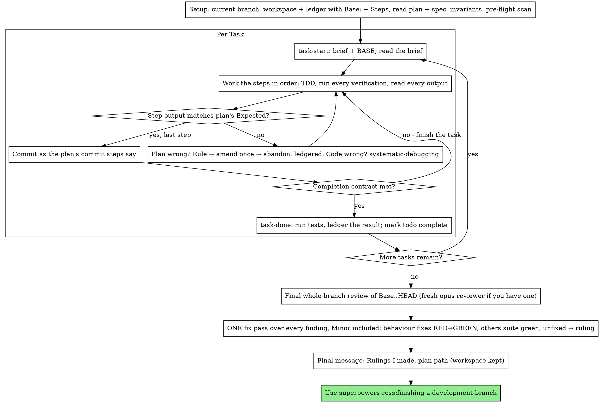

# Executing Plans

Execute the plan yourself, task by task, in this session: no implementer
subagent per task, no reviewer per task. One fresh-context review of the
whole branch at the end.

**Why inline:** Subagent-driven development pays for a fresh implementer
and a fresh reviewer on every task, each re-reading the codebase from zero.
Executing inline pays for one context (yours) plus one reviewer at the end.
What it gives up is a fresh context per task and a second pair of eyes per
task. This skill keeps what those two things bought, by other means: the
brief is the spec, the ledger is your memory, TDD is the per-task gate, and
the final reviewer is the second pair of eyes.

**Core principle:** The plan already did the thinking. Execute it exactly,
prove each step with a test you watched fail and then pass, and leave a
record that survives your own forgetting.

**Narration:** between tool calls, narrate at most one short line — the
ledger and the tool results carry the record.

**Continuous execution:** Do not pause to check in with your human partner
between tasks. This skill runs to spend less, not to have them answer
"should I continue?" after every task. Execute all tasks from the plan to
the end; nothing below waits on them.

**Rulings, not stalls.** Conflicts, ambiguities, plan defects — decide them.
The spec is the binding authority, the plan is its argument, and your
judgment settles what neither answers. Record every decision in the ledger
as `Ruling: <what you decided> — <why> — <what it costs if wrong>`, and keep
going. Deviating from the plan without a ledgered ruling is a decision made
in secret.

Nothing pauses the run. Each case below is ruled and ledgered, and the run
goes on:

- **Unrecoverable actions are not taken.** Anything not recoverable from
  git history (`git clean`, `reset --hard`, deleting untracked or ignored
  data, touching data outside the repo), anything security-sensitive, and
  anything outward-facing (push, merge, publish). Ledger
  `Ruling: left for you — <action> — <why>` and continue with the rest.
  Everything else proceeds.
- **A task whose verification needs such an action** is done as far as it
  can be, closed with `task-done` on the tests that can run, and marked
  unverified:
  `Task <N>: Ruling: unverified — <the verification not run> — dependents: <...>`.
  When no test can run, there is no `task-done` line, so the ruling ends
  with ` (commits <BASE7>..<HEAD7>)` to keep the ledger's ranges chained.
  Its dependents proceed, and each is flagged in "Rulings I made".
- **A plan broken past guessing** gets a ruling on its most defensible
  reading. If no reading gives a path that works, the task goes down the
  ladder: rule → amend once → abandon (see "The plan is wrong" below).
- **Items the plan leaves to the builder** are ruled and ledgered the same
  way.

## The Steps

Your FIRST action on invoking this skill, before reading the plan: write
this skill's step list into the ledger (see Setup for where). It keeps the
final review and its fix pass from being skipped under load, and it
survives compaction where your memory of this skill does not. Copy it
exactly; do not paraphrase or shorten it.

```
## Steps (executing-plans)
Step 1. Resolve the workspace and check the ledger. Record Base and this step list.
Step 2. Read the plan and its spec. Run the pre-flight scan. Make sure an invariants list exists, with a search anchor on every line.
Step 3. For each task: task-start; read the brief; work the steps with TDD, comparing every Expected line; commit; task-done.
Step 4. Run the final whole-branch review on opus with the invariants.
Step 5. One fix pass fixes every finding at every grade, Minor included. Anything left unfixed needs a ruling.
Step 6. List the rulings I made, then run finishing-a-development-branch.
```

Before each task and after any compaction, re-read the most recent
`## Steps` block in the ledger and check where you are against it.

## When to Use

- superpowers-ross:writing-plans recommended this skill: the plan has few
  tasks, they are tightly coupled (each consumes what the last produced,
  so a fresh implementer per task would re-learn the same context), and a
  mistake that ships is cheap to find and fix — per-task review would add
  little the final review does not.
- Your harness has no subagent tool (see
  `../using-superpowers/references/claude-code-tools.md`). Never fabricate
  a dispatch; run the plan here.

A fully specified plan makes executing it here transcription plus testing:
it runs well on a mid-tier session model, and the one place the most
capable model earns its cost is the final review, which this skill
dispatches separately on `opus`.

Prefer superpowers-ross:subagent-driven-development when the plan has many
or loosely coupled tasks, when a shipped mistake would be expensive enough
to want a review gate on every task, or when the plan is long enough that
its later tasks would run on a compacted context. Running a long plan here
still works — the ledger is what makes it recoverable — but the last tasks
get the least of you.

## The Process



## Setup

Work on the current branch, whatever it is. Do not switch branches or
create one.

Conversation memory does not survive compaction. An inline executor that
loses its place re-implements tasks whose commits already exist — the same
failure as a controller re-dispatching them, paid for in your own context.
Track progress in a ledger file, not only in todos. Harness todos are a
live view; the ledger is the record.

The workspace and ledger are shared with superpowers-ross:subagent-driven-development
— same directory, same format — so a plan can change executors mid-flight
and the new one resumes from the same ledger.

- Each plan owns a workspace: at skill start, run
  `../subagent-driven-development/scripts/sdd-workspace PLAN_FILE` — it
  prints the plan's git-ignored directory
  (`<repo-root>/.superpowers/sdd/<plan-basename>/`), home to every
  artifact for THIS plan: ledger, briefs, review packages. Another plan's
  directory is never yours to read or write.
- Check for this plan's ledger at `<workspace>/progress.md`. If its first
  line names your plan file, a task is DONE when the ledger has a
  `Task <N>: complete` line, a `Task <N>: Ruling: abandoned` line, or a
  `Task <N>: Ruling: unverified` line that ends with `(commits …)` — do
  not redo it; resume at the first task with none of these. The ledger is
  shared with superpowers-ross:subagent-driven-development, so honour all
  three whichever executor wrote them. Their
  commits exist in git even when your context no longer remembers making
  them: after compaction, trust the ledger and `git log` over your own
  recollection. A ledger whose first line names a different plan file is
  another plan's progress: leave it and start your own, fresh.
- With no ledger of your own, create it now, before any `task-start` or
  `task-done`, with its identity as the first line and the commit the work
  starts from as the second:
  ```
  # SDD ledger — plan: <plan file path>
  Base: <git rev-parse HEAD, full sha>
  ```
  `Base:` is written once, here. On resume it is already there; never
  rewrite it. `task-done` refuses to run against a ledger without it, and
  the final review and superpowers-ross:finishing-a-development-branch both
  cut their range from it.
- Straight after `Base:`, append the `## Steps (executing-plans)` block
  from The Steps above. The first two lines stay the identity and `Base:`.
  On resume, find the most recent `## Steps` block: if it is another
  executor's (the plan changed executors) or there is none (a ledger from
  before step lists), append this skill's block before anything else. The
  ledger stays append-only.
- `git clean -fdx` will destroy the workspace (it's git-ignored scratch);
  if that happens, recover from `git log`.

Read the plan once, note its context and Global Constraints, and create a
todo per task. If the plan names a Spec, read that too: the spec is the
authority the plan argues from, and conflicts inside the plan resolve
against it. A plan with no reachable spec gets a ledger note saying so —
rulings made without one are provisional.

**REQUIRED SUB-SKILL:** load superpowers-ross:test-driven-development now,
before Task 1. It governs every step of every task below; a plan whose
steps already say "write the failing test first" does not exempt you
from reading it.

Before Task 1, scan the plan for conflicts between tasks. The plan's
Interfaces blocks tell you where to look: for every task that consumes
what an earlier task produces, one ledger row — the two tasks, what one
produces against what the other consumes, and what you found. Tasks that
share nothing get no row; a plan whose tasks share nothing gets the single
line `Pre-flight: no shared interfaces`. Rule on each conflict a row
surfaces with the spec as the binding authority, record the ruling beside
its row, and start Task 1. Each task's own text is checked when you read
its brief, not here.

**Invariants.** The plan's `## Invariants` section lists the rules that
must hold in code no task was asked to touch; the final reviewer checks
each across the whole codebase. During the pre-flight scan, check every
line has a search anchor (a symbol, pattern or file a grep finds); where
one is missing, find one and write the anchored list to
`<workspace>/invariants.md`. A plan with no Invariants section gets one
written from the spec and the codebase's conventions (including the
project's CLAUDE.md) into `<workspace>/invariants.md`: ledger
`Setup: invariants written by the executor (<count>)` and print the list
to your human partner in your next message, one line each, without waiting
for a reply. `None` in the plan means there is nothing to search.

## The Task Loop

Everything you print, and every tool result, stays resident in your
context for the rest of the session. Redirect long test output to a file
in the workspace and read its tail; read a brief, not the whole plan.

### 1. Take the task

- Run this skill's `scripts/task-start PLAN_FILE N`. It prints the brief
  path and BASE (the commit the task's range is cut from) in one call.
  Read the brief for every task, including ones you remember from setup:
  what you remember is a summary, the brief has the exact values,
  signatures, and test cases.
- Mark the task's todo in_progress.

Every tool call is a turn that re-reads your whole context. Bookkeeping
rides along with work — a ledger append in the same call as the commit,
never in a call of its own.

### 2. Work the steps

The plan's steps are already in RED-GREEN order; follow them in that
order under superpowers-ross:test-driven-development, loaded at setup. A test
step's code is written first and run first. Watching it fail is a step,
not a formality — a test that passes before the implementation exists is
a finding about the test.

Every step that runs a command has an `Expected:` line. Run the command,
read its output, and compare. Three outcomes:

- **Matches.** Next step.
- **The code is wrong.** Use superpowers-ross:systematic-debugging. Find the
  cause; never patch the symptom to make the step's output match.
- **The plan is wrong** — a step contradicts the spec, an interface from an
  earlier task doesn't match what this task consumes, a command that
  cannot work. Rule on the smallest change that satisfies the spec, ledger
  it as `Task <N>: Ruling: <finding> — <what you decided and why>`, and
  continue. The ruling is carried, not remembered: later tasks that touch
  the same interface read it from the ledger.

When no ruling gives the task a path that works, climb the ladder — there
is no implementer to re-dispatch, so it is short:

1. **Rule** on the most defensible reading, as above.
2. **Amend the task once.** Write the amendment into the task's brief in
   the workspace and ledger it as
   `Task <N>: Ruling: amended — <what changed> — <why>`. Never edit the
   plan file and never renumber tasks. One amendment; not a second.
   `task-start` rewrites the brief from the plan, so on resume re-apply
   any `Task <N>: Ruling: amended` line to the regenerated brief before
   working it.
3. **Abandon.** If the task left uncommitted changes, commit them as
   `wip: abandoned Task <N>` — never reset or clean them away. Then ledger
   `Task <N>: Ruling: abandoned — <why> — dependents: <each amended to stand alone, or abandoned too>`,
   ending with ` (commits <a7>..<b7>)` when the task left commits (the
   range runs from its BASE to HEAD, covering the `wip:` commit, so the
   ledger's ranges still chain). Then take the next task.

Commit as the plan's commit steps say. A task that spans several commits
is fine; BASE is what the review range is cut from, never `HEAD~1`.

### 3. The completion contract

Before a task's ledger line, all of the following are true, with evidence
in this session — not inferred from the diff looking right:

- Every test the brief names exists and ran in this task, and you read
  the output.
- The final test run for the task passed — `task-done` is that run, and
  it writes the command and result into the ledger line.
- Every `Expected:` line in the brief was compared against real output.
- Every deviation from the brief has a `Ruling:` line in the ledger.

**REQUIRED SUB-SKILL:** superpowers-ross:verification-before-completion governs
the claim. If any item is missing, the task is not complete: finish it.

### 4. Complete the task

Run this skill's `scripts/task-done PLAN_FILE N BASE -- <test command>`
with the test command the brief names for the whole task. It runs the
tests, keeps the full output in the workspace, prints the tail, and — only
if they pass — appends the completion line to the ledger:

`Task <N>: complete (commits <base7>..<head7>, tests: <command> → <result>)`

A failing run records nothing; the task is not complete. When it records,
mark the todo complete and take the next task.

## Final Review

Run `../subagent-driven-development/scripts/review-package PLAN_FILE <Base> HEAD`
(`<Base>` = the ledger's `Base:` line) and review from the file it prints.
Its first line gives the package's total line count.

**With a subagent tool:** dispatch the reviewer with `model: "opus"` — the
whole-branch review is a judgment task — using
superpowers-ross:requesting-code-review's
[code-reviewer.md](../requesting-code-review/code-reviewer.md), with the
package path, the plan and spec paths, the invariants list verbatim (it
checks each across the whole codebase, not only the diff, and reports the
search terms, hit count and files read), the plan's Review Focus section
verbatim if it has one (the input classes and failure modes the plan's
tests do not exercise — the reviewer checks each deliberately), and a
pointer to the ledger's `Ruling:` lines so it can weigh the calls you
made. Specify the model
explicitly; an omitted model inherits the session's, which may not be the
most capable. This is the one fresh context the whole run buys. Do not
skip it, and do not replace it with your own read of the diff.

The reviewer reads the package in ~1,000-line chunks with Read's `offset`
until a Read returns the end, halving the chunk if a Read fails on size,
reading each part once, and states "read through line L". A report without
that statement is re-dispatched once; if the second also lacks it, rule on
what to do with it and ledger the ruling.

**Without a subagent tool:** read code-reviewer.md and perform that review
yourself against the package in the same chunks, as a separate pass after
the last task's ledger line. Ledger
`Final: Ruling: self-review only — no subagent tool — the author's blind spots went unchecked`
and list it first in "Rulings I made": a self-review by the author is
weaker than a fresh reviewer, and your human partner should know which
review the branch got.

Sort the findings before you act on any of them. The reviewer's severity
labels are advice; the gate is yours. Its "Declined to judge" list is
yours too: every line there is a ruling you make and ledger, exactly like
a plan conflict — `Final: Ruling: <behavior the reviewer set aside> —
<what a reasonable person using this software gets, and why that stands
or why it is now a finding> — <cost if wrong>`. Re-grade first, by effect: the
spec is a vision document, and a finding's grade is what a reasonable
person using this software gets if it ships, not whether the spec names
the input that triggers it — a reviewer who set a finding at Minor
because the spec was silent has graded the spec, not the effect. Then:

- **Every finding enters the fix pass**, Critical through Minor. A Minor
  left for later is never picked up: this pass is the last one.

Fix them yourself — you are the implementer here — in ONE pass:

- **A fix that changes behaviour** is verified by TDD, not by a second
  reviewer: write the test that reproduces the finding, watch it fail,
  make it pass, then run the whole suite. Ledger
  `Final: fixed <finding> — <test name> RED→GREEN, suite <N>/<N>`.
- **A fix that changes no behaviour** (naming, duplication, structure,
  docs) has no failing test to write. It is verified by the whole suite
  staying green. Ledger
  `Final: fixed <finding> — no behaviour change, suite <N>/<N>`. When the
pass is over, ledger the wave as `Final review: fixes (commits <a7>..<b7>)`,
from the HEAD before the first fix to the HEAD after the last — or
`Final review: clean` when there was nothing to fix. A fix
without a test that failed first is not verified; a suite that is not
green after the pass means the pass is not over. Do not dispatch a
re-review: it would re-read a diff whose covering tests already answer
"addressed" and whose suite run already answers "broke nothing".

A finding you do not fix is a ruling —
`Final: Ruling: not fixed — <finding> — <wrong: why | not a code change | fix failed: what was tried> — <cost if wrong>`
— and reaches your human partner in the rulings list. "Not worth it",
"polish" and "can wait" are not reasons. There is no second fix pass.

## Finish

Collect every ledger line containing `Ruling:` into your final message
under "Rulings I made", each with what it costs if wrong. List first, in
this order: abandoned tasks, "left for you" actions, unverified tasks (with
the dependents flagged under each), and residual load-bearing findings —
final-review findings you ruled not to fix. Then every other ruling, in
the order you made them. The list is exhaustive. Your final message is the
only place the decisions you took on your human partner's behalf — and the
findings you did not fix — reach them. End it with the plan path.

Do not delete the workspace: superpowers-ross:finishing-a-development-branch
reads `Base:` and the chained commit ranges from the ledger, and deletes the
workspace when it is done.

Use superpowers-ross:finishing-a-development-branch.

## Common Rationalizations

| Excuse | Reality |
|--------|---------|
| "I remember what Task N says" | You remember a summary. The brief has the exact values. Read it. |
| "The plan's code is right, skip watching the test fail" | A test you never saw fail proves nothing. It is one step. Run it. |
| "I'll run the full suite at the end instead of per step" | Per-step runs are how you learn which step broke it. The end-of-task run is the contract, not a substitute. |
| "The plan is wrong here, I'll just do the right thing" | Do the right thing and ledger the ruling. Unledgered deviation is a decision made in secret. |
| "I'll write the ledger lines after a few tasks" | Compaction does not wait for a convenient moment. One line per task, in the same message as the commit. |
| "Let me check in before the next task" | This skill runs to spend less. Progress prompts spend their time instead. Nothing pauses the run: rule, ledger, continue. |
| "This needs a push / a `reset --hard` / a deploy — I'll wait for them" | Don't take it and don't wait. Ledger `Ruling: left for you`, mark what it leaves unverified, and continue. |
| "The plan is too broken; better to hand it back" | Rule on the most defensible reading, amend once, or abandon the task. Each is ledgered; the run goes on. |
| "I read my own diff carefully; the final reviewer is redundant" | Same author, same blind spots. The reviewer is the only fresh context this run buys. |
| "Tests should pass, the change was trivial" | "Should" is not evidence. The contract requires the command and its output. |
| "Subagents are slow and expensive, I'll skip the final review too" | Inline already removed the per-task reviewers. One review of the whole branch is the floor, not the ceiling. |
| "The reviewer said Minor, so it's Minor" | The label graded the spec's silence. Grade what the person gets. Re-grade, then gate. |
| "The fix is obvious, no need for a failing test first" | The failing test is the only proof the finding was real and is now gone. Without it you have a diff and a hope. |
| "Minors can wait for another day" | No later pass exists. Fix them in this pass, or rule each one not fixed with a real reason. |
| "This Minor has no test, so I can't fix it properly" | A no-behaviour fix is verified by the suite staying green. Fix it and ledger that. |
| "I know the steps, no need to write them to the ledger" | The step list is for after compaction, when you don't. Write it first, re-read it before each task. |

## Example Workflow

```
You: I'm using the executing-plans skill to implement this plan.

[Read plan once: docs/superpowers/plans/feature-plan.md; spec read]
[Resolve workspace: sdd-workspace docs/superpowers/plans/feature-plan.md — no ledger inside, fresh start]
[Ledger created: identity line + Base: 9f8e7d6c5b4a39281706f5e4d3c2b1a098765432 + the ## Steps block, verbatim]
[Plan's Invariants: 1 line, anchored — "hooks only under ~/.config/superpowers/hooks (anchor: HOOK_DIR)"]
[Pre-flight scan: 2 shared-interface rows, 4 self-consistency rows, clean; written to ledger]
[Create todos for all tasks]

Task 1: Hook installation script

[task-start plan 1 → brief read; BASE a1b2c3d]
[Step 1: write failing test — written]
[Step 2: run it — FAIL: install_hook not defined. Matches Expected.]
[Step 3: implement — written]
[Step 4: run it — PASS 1/1. Matches Expected.]
[Step 5: commit — d4e5f6a]
[Contract: tests ran, output read, no deviations]
[task-done plan 1 a1b2c3d -- npm test -- hooks → ledger: Task 1: complete (commits a1b2c3d..d4e5f6a, tests: npm test -- hooks → 1/1 pass)]

Task 2: Recovery modes

[task-start plan 2 → brief read; BASE d4e5f6a]
[Step 2: run failing test — FAIL, but on an import error: Task 1 exported
 installHook, brief consumes install_hook]
[Ruling: brief's consumer name is a typo against Task 1's Produces block;
 use installHook — Ledger: Task 2: Ruling: install_hook → installHook — matches Task 1 Produces — cost if wrong: one rename]
[Steps 2-5 as planned; commit b7c8d9e]
[task-done plan 2 d4e5f6a -- npm test -- recovery → ledger: Task 2: complete (commits d4e5f6a..b7c8d9e, tests: npm test -- recovery → 8/8 pass)]

...

[After all tasks: review-package plan 9f8e7d6 HEAD; dispatch code-reviewer, model opus, with the invariants]
Reviewer: read through line 812. Invariant holds (search evidence given). One Important finding — progress reporting interval hardcoded. Two Minor.
[Re-grade: Important stands; both Minors enter the pass too]
[Fix pass: test_progress_interval_configurable RED → extract PROGRESS_INTERVAL → GREEN; suite 12/12]
[README usage example added; recovery.js split into verify.js/repair.js; suite 12/12; commit]
[Ledger: Final: fixed hardcoded interval — test_progress_interval_configurable RED→GREEN, suite 12/12]
[Ledger: Final: fixed README usage example — no behaviour change, suite 12/12]
[Ledger: Final: fixed verify/repair split — no behaviour change, suite 12/12]
[Ledger: Final review: fixes (commits e1f2a3b..c4d5e6f)]

Rulings I made:
- Task 2: install_hook → installHook (brief typo; cost if wrong: one rename)

Plan: docs/superpowers/plans/feature-plan.md

Using superpowers-ross:finishing-a-development-branch.
```
