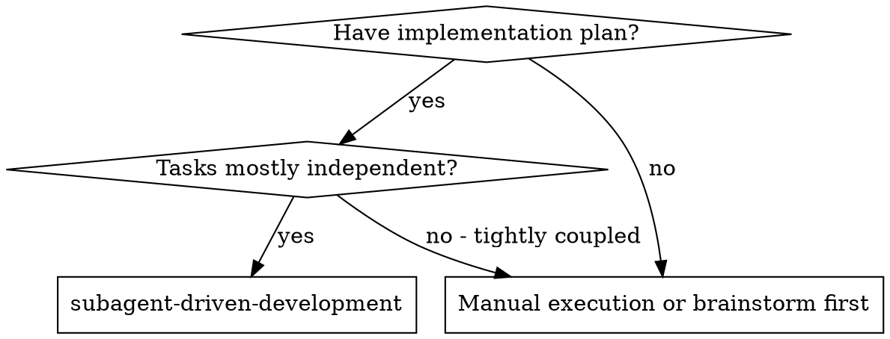

# Subagent-Driven Development

Execute a plan by dispatching a fresh subagent per task, with two reviews after each — spec compliance and code quality — dispatched in parallel.

**Why subagents:** You delegate tasks to specialized agents with isolated context. By precisely crafting their instructions and context, you ensure they stay focused and succeed at their task. They should never inherit your session's context or history — you construct exactly what they need. This also preserves your own context for coordination work.

**Core principle:** Fresh subagent per task + parallel two-track review (spec + quality) = high quality, fast iteration

**Continuous execution:** Do not pause to check in with your human partner between tasks. Execute all tasks from the plan without stopping. The only reasons to stop are: a BLOCKED status you cannot resolve, a genuinely critical question that prevents progress, or all tasks complete. "Should I continue?" prompts and progress summaries waste their time — they asked you to execute the plan, so execute it.

## Orientation: Summarize the Loop First

Your FIRST action on invoking this skill, before reading the plan or touching any task: print a concise numbered summary of the full loop to yourself. This keeps the review and bookkeeping steps from being skipped under cognitive load. The summary enumerates:

1. Capture the base SHA; resolve this plan's workspace and check its ledger.
2. Read the plan and build the task list (full text + metadata).
3. Per task: record BASE → dispatch implementer → generate the review package → dispatch spec reviewer + code reviewer in parallel → fix rounds (max 5), re-running only the addressed reviewer → append the completion line to the ledger → mark the task completed.
4. After the last task: dispatch the final whole-implementation code reviewer → one fix wave → one scoped re-review → adjudicate residuals.
5. Delete this plan's workspace, then hand off to `finishing-a-development-branch`, which squashes and summarizes.

## When to Use



## Branch

Work on the current branch, whatever it is — usually `master` or `main`. Do not switch branches, and do not create a worktree. If work belongs on a different branch, the user has already switched to it before invoking this skill.

## The Process

```dot
digraph process {
    rankdir=TB;

    "Print loop summary to self" [shape=box];
    "Capture base SHA" [shape=box];
    "Resolve workspace, check ledger" [shape=box];
    "Read plan, create tasks (full text + metadata)" [shape=box];

    subgraph cluster_per_task {
        label="Per Task";
        "Record BASE; dispatch implementer (./implementer-prompt.md)" [shape=box];
        "Implementer asks questions?" [shape=diamond];
        "Answer questions, provide context" [shape=box];
        "Implementer implements, tests, commits, self-reviews" [shape=box];
        "Generate review package; dispatch spec reviewer (cheap) + code reviewer (orchestrator tier) in PARALLEL" [shape=box];
        "Spec OK and quality approved?" [shape=diamond];
        "Finding conflicts with plan text?" [shape=diamond];
        "Ask human partner which governs" [shape=box];
        "Fix round R of 5: R<=3 resume implementer; R>=4 fresh implementer, more capable model" [shape=box];
        "Scoped re-review (./re-review-prompt.md) of ONLY the addressed reviewer's findings" [shape=box];
        "All findings addressed?" [shape=diamond];
        "R = 5?" [shape=diamond];
        "Adjudicate each open finding" [shape=box];
        "Any load-bearing finding?" [shape=diamond];
        "STOP: report BLOCKED to human partner" [shape=box];
        "Park findings in ledger with rulings" [shape=box];
        "Append completion to ledger; TaskUpdate completed + sync .tasks.json" [shape=box];
    }

    "More tasks remain?" [shape=diamond];
    "Dispatch final code reviewer (../requesting-code-review/code-reviewer.md)" [shape=box];
    "Final findings? ONE fix dispatch, one scoped re-review, adjudicate residuals" [shape=box];
    "Final review clean: delete this plan's workspace" [shape=box];
    "Use superpowers-ross:finishing-a-development-branch (squash + summary)" [shape=box style=filled fillcolor=lightgreen];

    "Print loop summary to self" -> "Capture base SHA";
    "Capture base SHA" -> "Resolve workspace, check ledger";
    "Resolve workspace, check ledger" -> "Read plan, create tasks (full text + metadata)";
    "Read plan, create tasks (full text + metadata)" -> "Record BASE; dispatch implementer (./implementer-prompt.md)";
    "Record BASE; dispatch implementer (./implementer-prompt.md)" -> "Implementer asks questions?";
    "Implementer asks questions?" -> "Answer questions, provide context" [label="yes"];
    "Answer questions, provide context" -> "Implementer implements, tests, commits, self-reviews";
    "Implementer asks questions?" -> "Implementer implements, tests, commits, self-reviews" [label="no"];
    "Implementer implements, tests, commits, self-reviews" -> "Generate review package; dispatch spec reviewer (cheap) + code reviewer (orchestrator tier) in PARALLEL";
    "Generate review package; dispatch spec reviewer (cheap) + code reviewer (orchestrator tier) in PARALLEL" -> "Spec OK and quality approved?";
    "Spec OK and quality approved?" -> "Append completion to ledger; TaskUpdate completed + sync .tasks.json" [label="yes"];
    "Spec OK and quality approved?" -> "Finding conflicts with plan text?" [label="no"];
    "Finding conflicts with plan text?" -> "Ask human partner which governs" [label="yes"];
    "Ask human partner which governs" -> "Fix round R of 5: R<=3 resume implementer; R>=4 fresh implementer, more capable model";
    "Finding conflicts with plan text?" -> "Fix round R of 5: R<=3 resume implementer; R>=4 fresh implementer, more capable model" [label="no"];
    "Fix round R of 5: R<=3 resume implementer; R>=4 fresh implementer, more capable model" -> "Scoped re-review (./re-review-prompt.md) of ONLY the addressed reviewer's findings";
    "Scoped re-review (./re-review-prompt.md) of ONLY the addressed reviewer's findings" -> "All findings addressed?";
    "All findings addressed?" -> "Append completion to ledger; TaskUpdate completed + sync .tasks.json" [label="yes"];
    "All findings addressed?" -> "R = 5?" [label="no"];
    "R = 5?" -> "Fix round R of 5: R<=3 resume implementer; R>=4 fresh implementer, more capable model" [label="no - next round"];
    "R = 5?" -> "Adjudicate each open finding" [label="yes - breaker trips"];
    "Adjudicate each open finding" -> "Any load-bearing finding?";
    "Any load-bearing finding?" -> "STOP: report BLOCKED to human partner" [label="yes"];
    "Any load-bearing finding?" -> "Park findings in ledger with rulings" [label="no"];
    "Park findings in ledger with rulings" -> "Append completion to ledger; TaskUpdate completed + sync .tasks.json";
    "Append completion to ledger; TaskUpdate completed + sync .tasks.json" -> "More tasks remain?";
    "More tasks remain?" -> "Record BASE; dispatch implementer (./implementer-prompt.md)" [label="yes"];
    "More tasks remain?" -> "Dispatch final code reviewer (../requesting-code-review/code-reviewer.md)" [label="no"];
    "Dispatch final code reviewer (../requesting-code-review/code-reviewer.md)" -> "Final findings? ONE fix dispatch, one scoped re-review, adjudicate residuals";
    "Final findings? ONE fix dispatch, one scoped re-review, adjudicate residuals" -> "Final review clean: delete this plan's workspace";
    "Final review clean: delete this plan's workspace" -> "Use superpowers-ross:finishing-a-development-branch (squash + summary)";
}
```



## Start: Capture Base SHA

Before creating any tasks, record the squash anchor:

```bash
git rev-parse HEAD
```

This is the base SHA — HEAD before any task work. Store it as the top-level `"baseSha"` field in the `.tasks.json` persistence file (see Building the Task List) so it survives `/compact` and the separate `finishing-a-development-branch` invocation, where it anchors the squash. It also anchors the final whole-branch review package. It is distinct from the per-task BASE you record before each implementer dispatch, which scopes that task's review package.

## Setup: Workspace and Ledger

Conversation memory does not survive compaction. In real sessions, controllers that lost their place have re-dispatched entire completed task sequences — the single most expensive failure observed. Track progress in a ledger file, not only in the task list.

- Each plan owns a workspace: at skill start, run this skill's
  `scripts/sdd-workspace PLAN_FILE` — it prints the plan's git-ignored
  directory (`<repo-root>/.superpowers/sdd/<plan-basename>/`), home to
  every artifact for THIS plan: ledger, briefs, reports, review packages.
  Another plan's directory is never yours to read or write.
- Check for this plan's ledger at `<workspace>/progress.md`. If its first
  line names your plan file, tasks with a `Task <N>: complete` line are DONE
  — do not re-dispatch them; resume at the first task without one. A task
  whose last line is a fix round is mid-loop: resume the loop at the next
  round. A ledger whose first line names a different plan file — or a stray
  ledger at the old flat path `.superpowers/sdd/progress.md` — is another
  plan's progress: leave it in place and start your own, fresh.
- Create the ledger with its identity as the first line:
  `# SDD ledger — plan: <plan file path>`.
- The ledger is your recovery map: the commits it names exist in git even
  when your context no longer remembers creating them. After compaction,
  trust the ledger and `git log` over your own recollection.
- `git clean -fdx` will destroy the workspace (it's git-ignored scratch); if
  that happens, recover from `git log`.
- The ledger records STATE, not reasoning. Entries are the one-line forms
  in this skill (dispatch, fix round, complete, minor, parked, BLOCKED) —
  one event, one line; only a parked ruling may run to three. No
  methodology narration, no reviewer praise, no self-correction essays, no
  restating an earlier entry's facts — every extra line is re-read on
  every later turn. A lesson about your own process is not state: put it
  in your final report to your human partner, because the workspace (this
  file included) is deleted at Finish and anything written here dies with
  it.
- Append entries with a shell append (`cat >> progress.md <<'EOF'`), not
  the Edit tool — Edit re-sends anchor text that grows with the file and
  fires a permission prompt for every entry.

Then read the plan once, note its context and Global Constraints, and build the task list.

## Building the Task List

Read the plan once, extract every task with full text, and create a native task per plan task. Embed metadata as a `json:metadata` code fence at the end of each description — the `metadata` parameter on TaskCreate is accepted but not returned by TaskGet, so the fence is the only form that survives.

### User-Thrown Gates — Mechanical Detection + Tagging

Run this check for EVERY task you create. It takes seconds and is the cheapest part of the whole user-gate flow.

**Step 1 — Scan for gate-language.** For each of these, search the user's brief AND the task's Goal/Acceptance Criteria, case-insensitive, whole-word where reasonable:

| Bucket | Keywords / patterns |
|--------|---------------------|
| Verbs | `verify`, `prove`, `validate`, `confirm`, `ensure`, `check`, `gate` |
| Nouns | `verification gate`, `acceptance test`, `smoke test`, `end-to-end`, `E2E` |
| Scope | `first on one`, `then all`, `one before the rest`, `before proceeding`, `don't continue until` |
| Proof | `prove it works`, `make sure`, `demonstrate`, `show that` |

**Trigger rule** — a task is a user-thrown gate ONLY if:
- a **Nouns** match is found (these phrases are unambiguous gate nouns), OR
- a **Scope** match is found (commitment to ordering is a gate by itself), OR
- a **Verbs** match co-occurs with EITHER a Scope or a Proof match.

A **Verbs** match ALONE is not enough. Normal work briefs routinely say "validate the output" or "check that imports work" without asking for a gate. If the user wanted a gate, they committed to ordering ("do X before Y", "first on one"), named the artifact ("smoke test", "acceptance test"), or demanded proof ("prove it works", "show that"). One of those MUST be present in addition to the verb.

If no bucket matches, or only Verbs match → regular task, no tagging needed.

**Step 2 — Tag the task.** In the task's `json:metadata` fence:

1. Set `"userGate": true`.
2. Append `"user-gate"` to the `tags` array (create the array if absent).
3. If the user's brief specified the HOW concretely (named a command, entity, subagent, or observable), put it straight into `verifyCommand` and `acceptanceCriteria` — done.
4. If HOW is vague, set `"requiresUserSpecification": true` **only** when the verification sentence names no testable noun (function, command, entity, endpoint, file, log pattern) AND no concrete value (expected result, threshold, example input/output). One foothold — e.g. "verify each op with real inputs" — is enough for the agent to self-solve. The flag is for pure adjectives ("solid", "works", "good", "proper") where any guess is a shot in the dark.

**Step 3 — Add the prose banner** (mandatory whenever `userGate: true`). Near the top of the task description, right under **Goal:**, include verbatim:

> **USER-ORDERED GATE — NON-SKIPPABLE.** This task was requested by the user in the current conversation. It MUST NOT be closed by walking around it, by declaring it "verified inline", or by substituting a cheaper check. Close only after every item in `acceptanceCriteria` has been re-validated independently, with output captured.

**Tasks with declared evidence axes — set `requireEvidenceTokens`.** When a task's close is meaningful only if the coordinator has actually observed two (or more) labeled states, declare the axes in metadata. The `post-task-complete-revalidate` hook refuses the close unless at least one token from each axis appears in the close window. Examples:

- **Empirical refactor / A/B:** either explicit (`"requireEvidenceTokens": [["baseline","old","iter-0"], ["refactored","new","iter-1"]]`) or shortcut (`"requireABCompare": true`).
- **v2→v3 migration verification:** `"requireEvidenceTokens": [["v2","legacy"], ["v3","migrated"]]`.
- **Perf before/after:** `[["slow","unoptimized","p50=X"], ["fast","optimized","p50=Y"]]` — include the literal metric tags you expect the coordinator to post.
- **Multi-arm experiment:** `[["control"], ["variant-a"], ["variant-b"]]` — any number of axes.
- **Security pre/post fix:** `[["vulnerable","CVE-","before-patch"], ["patched","after-patch","hardened"]]`.

Without the axes, "looks good, keep going" closes are legal; with axes, the coordinator must produce evidence from each declared side. Pair with a concrete `verifyCommand` that actually runs both sides when possible (e.g. `diff <(old-cmd) <(new-cmd)`).

**Banner ↔ metadata invariant.** The banner goes inside the SAME TaskCreate `description` string as the `json:metadata` fence. For each task, the description must either carry `userGate: true` + banner + fence together, or none of them.

**Step 4 — Check acceptance criteria operational specificity.** Each criterion MUST name an observable. Vague ("integration works", "it passes") is not acceptable — rewrite to "sensor X reports idle", "HTTP 200 from `/health`", "setup.done file present", etc. If you cannot make a criterion operational, set `requiresUserSpecification: true` and let `/specify-gate` collect the real answer.

**Step 5 — Per-task isolation self-check.** For every task where you set `userGate: true` and DIDN'T set `requiresUserSpecification: true`, re-read ONLY that task's **Goal** sentence in isolation — pretend no other task exists. Does that sentence alone name an observable, a capture method, AND a pass/fail value? If no to any of the three, set `requiresUserSpecification: true` even if you already filled in a `verifyCommand` from context. Borrowing concreteness from sibling tasks is the failure mode this catches.

**Tag liberally when a real gate signal is present.** The three shades of gate (strict user gate / strict agent gate / gray in-between) all get the same tag — if the trigger rule above matches, err on the side of tagging. But do not read a gate into normal verbs: "validate", "check", "verify" on their own describe routine work. Over-tagging on real signals is harmless (extra metadata). Over-tagging on bare verbs produces a banner flood that drowns the real gates.

**Do not ask the user gate questions while building the task list.** The opinionated default is "tag it and move on". When the user's brief is vague about a gate's HOW, `requiresUserSpecification: true` routes the question to gate-check time, where `/specify-gate` handles it in 3-5 short multiple-choice prompts.

See `skills/shared/task-format-reference.md` → "User-Thrown Gates" for the full metadata schema (`userGate`, `tags`, `requiresUserSpecification`, `gateScope`, `failurePolicy`, `subagentBrief`), and `docs/user-gate-flow.md` for the end-to-end flow.

### TaskCreate description — full structured body

Every TaskCreate `description` MUST contain, verbatim, the same **Goal / Files / Acceptance Criteria / Verify** sections the plan `.md` holds for that task. Do NOT condense into a one-sentence summary. Do NOT move the AC to "see the plan doc". Do NOT omit `**Verify:**`. The description MUST end with the `json:metadata` code fence.

The implementer subagent works from its brief file, but you and the reviewers read the task description via TaskGet — a one-sentence description makes every later step improvise the AC. The plan `.md` is not a fallback — TaskGet does not read it.

**Self-check:** after TaskCreate for every task, open each description (via TaskGet or by reading `.tasks.json`) and confirm all four section headers (`**Goal:**`, `**Files:**`, `**Acceptance Criteria:**`, `**Verify:**`) AND the `json:metadata` fence are present. If any is missing → TaskUpdate the description to the full block.

```yaml
TaskCreate:
  subject: "Task N: [Component Name]"
  description: |
    **Goal:** [From task's Goal line]

    **Files:**
    [From task's Files section]

    **Acceptance Criteria:**
    [From task's Acceptance Criteria]

    **Verify:** [From task's Verify line]

    **Steps:**
    [Key actions from task's Steps — abbreviated]

    ```json:metadata
    {"files": ["path/to/file1.py"], "verifyCommand": "pytest tests/path/ -v", "acceptanceCriteria": ["criterion 1", "criterion 2"], "modelTier": "mechanical"}
    ```
  activeForm: "Implementing [Component Name]"
```

### Dependencies and persistence

After all tasks are created, set `blockedBy` relationships:

```
TaskUpdate:
  taskId: [task-id]
  addBlockedBy: [prerequisite-task-ids]
```

Write the persistence file co-located with the plan. If the plan is `docs/superpowers/plans/2026-01-15-feature.md`, the file is `docs/superpowers/plans/2026-01-15-feature.md.tasks.json`:

```json
{
  "planPath": "docs/superpowers/plans/2026-01-15-feature.md",
  "baseSha": "<sha captured at start>",
  "tasks": [
    {
      "id": 0,
      "subject": "Task 0: ...",
      "status": "pending",
      "description": "**Goal:** ...\n\n```json:metadata\n{\"files\": [\"path/to/file.py\"], \"verifyCommand\": \"pytest tests/ -v\", \"acceptanceCriteria\": [\"criterion 1\"], \"modelTier\": \"mechanical\"}\n```"
    }
  ],
  "lastUpdated": "<timestamp>"
}
```

Any new session resumes with `/superpowers-ross:subagent-driven-development <plan-path>`, which reads `.tasks.json` and this plan's ledger, and continues from where it left off.

## Dispatching with Metadata

When dispatching an implementer subagent:
1. Read the task's description via TaskGet — metadata is embedded as a `json:metadata` code fence at the end
2. Parse the metadata JSON and map fields (files, acceptanceCriteria, verifyCommand) to the implementer prompt sections
3. The implementer should receive ALL structured data — don't make them parse it from prose
4. For user-gate tasks, do not re-decide what the plan settled: dispatch the settled verification as written unless a material condition changed since planning (different fixture/branch, new blocker, broken plan assumption) — re-asking a settled approach with no changed condition is walking around the gate.

## Model Selection

Use the least powerful model that can handle each role, to conserve cost and increase speed. **Sonnet is the default ceiling** — favor sonnet or cheaper, and reserve opus for the rare case that genuinely cannot be done without it.

**Task complexity signals (implementation tasks):**
- Touches 1-2 files with a complete spec → cheap model (haiku). Most well-specified implementation tasks are mechanical.
- Touches multiple files with integration concerns → sonnet.
- Requires design judgment or broad codebase understanding → still default to sonnet. Escalate to opus only when sonnet has actually struggled (e.g. a BLOCKED return) or the task is unmistakably beyond it — this should be uncommon.

**Spec compliance reviewer:** the cheap/mechanical tier. Comparison work, not judgment work.

**Code quality reviewer:** the orchestrator's session tier — sonnet by default, even when this orchestrator runs on opus. Escalate to opus only for a genuinely subtle, design-heavy change. For a small, mechanical, or otherwise trivial task you MAY drop to haiku or skip this reviewer; the spec reviewer is never skippable.

**Scoped re-reviews** of small fix diffs take a cheap-to-mid tier.

**Fix-loop escalation (rounds 4-5):** use a model at least one tier above the implementer that got stuck.

**Always specify the model explicitly when dispatching a subagent.** An omitted model inherits your session's model — often the most capable and most expensive — which silently defeats this section.

**Turn count beats token price.** Wall-clock and context cost scale with how many turns a subagent takes, and the cheapest models routinely take 2-3× the turns on multi-step work — costing more overall. Use a mid-tier model as the floor for implementers working from prose descriptions. When the task's plan text contains the complete code to write, the implementation is transcription plus testing: use the cheapest tier for that implementer. Single-file mechanical fixes also take the cheapest tier.

## The Task Loop

Everything you paste into a dispatch prompt — and everything a subagent prints back — stays resident in your context for the rest of the session and is re-read on every later turn. Hand artifacts over as files.

### 1. Dispatch the implementer

Record BASE (`git rev-parse HEAD`) before dispatching — the review package and fix-round diffs need it.

- **Task brief:** before dispatching an implementer, run this skill's
  `scripts/task-brief PLAN_FILE N` — it extracts the task's full text to a
  uniquely named file and prints the path. Compose the dispatch so the
  brief stays the single source of
  requirements. Your dispatch should contain: (1) one line on where this
  task fits in the project; (2) the brief path, introduced as "read this
  first — it is your requirements, with the exact values to use verbatim";
  (3) interfaces and decisions from earlier tasks that the brief cannot
  know; (4) your resolution of any ambiguity you noticed in the brief;
  (5) the report-file path and report contract. Exact values (numbers,
  magic strings, signatures, test cases) appear only in the brief. Never
  make a subagent read the whole plan file.
- **Report file:** name the implementer's report file after the brief
  (brief `…/task-N-brief.md` → report `…/task-N-report.md`) and put it in
  the dispatch prompt. The implementer writes the full report there and
  returns only status, commits, a one-line test summary, and concerns.
- A dispatch prompt describes one task, not the session's history. Do not
  paste accumulated prior-task summaries ("state after Tasks 1-3") into
  later dispatches — a real session's dispatch hit 42k chars of which 99%
  was pasted history. A fresh subagent needs its task, the interfaces it
  touches, and the global constraints. Nothing else.
- If an earlier task parked a finding in the area this task touches, carry
  a pointer to that ledger entry in the dispatch.
- Record the implementer's agent identity from the dispatch result —
  fix-loop rounds 1-3 resume this agent.
- Do not dispatch multiple implementation subagents in parallel unless they
  pass the disjointness test in Bounded Parallel Dispatch.

Template: [implementer-prompt.md](implementer-prompt.md)

### 2. Handle the report

Implementer subagents report one of four statuses. Handle each appropriately:

**DONE:** Generate the review package (`scripts/review-package PLAN_FILE BASE HEAD`, from this skill's directory — it prints the unique file path it wrote; BASE is the commit you recorded before dispatching the implementer — never `HEAD~1`, which silently drops all but the last commit of a multi-commit task), then dispatch both reviewers with the printed path. Generate the package only after the implementer's report lands, never while it is still working — the diff is a moving target and a pre-generated package arrives stale.

**DONE_WITH_CONCERNS:** The implementer completed the work but flagged doubts. Read the concerns before proceeding. If the concerns are about correctness or scope, address them before review. If they're observations (e.g., "this file is getting large"), note them and proceed to review.

**NEEDS_CONTEXT:** The implementer needs information that wasn't provided. Provide the missing context and re-dispatch.

**BLOCKED:** The implementer cannot complete the task. Assess the blocker:
1. If it's a context problem, provide more context and re-dispatch with the same model
2. If the task requires more reasoning, re-dispatch one tier up (typically haiku → sonnet). Reach for opus only if sonnet has also returned BLOCKED.
3. If the task is too large, break it into smaller pieces
4. If the plan itself is wrong, escalate to the human

**Never** ignore an escalation or force the same model to retry without changes. If the implementer said it's stuck, something needs to change.

If the implementer asks questions — before starting or mid-task — answer clearly and completely, provide additional context if needed, and don't rush it into implementation.

## Escalating Questions to Your Human Partner

Before ANY execution-time AskUserQuestion — plan-scripted or relayed from an implementer:
1. Re-read the plan header's "User decisions (already made)". If a recorded decision answers the question, use that answer instead of asking.
2. If you do ask: name the artifact AND its role/state from the plan's facts (not just its name), and make each option description say what changes and what stays the same. Your human partner does not hold the plan in their head — an unanchored recommendation reads as a new proposal.

### 3. Review the task — two reviewers, in parallel

Per-task reviews are task-scoped gates. The broad review happens once, at the final whole-branch review. Never skip the spec review, and never accept a task as done without the verdict of every reviewer that ran — spec compliance AND task quality. Implementer self-review never replaces the task review; both are needed.

After the implementer reports DONE and the review package is generated, dispatch BOTH reviewers **concurrently** — they are read-only, so parallel dispatch is safe, and neither waits on the other:

- **Spec compliance reviewer** ([spec-reviewer-prompt.md](spec-reviewer-prompt.md)) — confirms the code matches the spec, nothing missing and nothing extra. Cheap/mechanical tier.
- **Code quality reviewer** ([code-quality-reviewer-prompt.md](code-quality-reviewer-prompt.md)) — confirms the implementation is well-built. Orchestrator tier.

Mark every reviewer and review-fix dispatch with `[sdd-review]` in the Agent call's `description`. That exempts them from the model-routing gate (see `hooks/pre-agent-model-routing`), so their dispatch-time tiers apply regardless of any active routing file.

**Reviewer inputs.** Each reviewer gets three paths — the task brief file, the implementer's report file, and the review package — plus the global constraints that bind the task.

- Hand each reviewer its diff as a file: run this skill's
  `scripts/review-package PLAN_FILE BASE HEAD` **once** and pass BOTH reviewers
  the same printed path (or, without bash: `git log --oneline`, `git diff --stat`,
  and `git diff -U10` for the range, redirected to one uniquely named
  file). The output never enters your own context, and each reviewer sees
  the commit list, stat summary, and full diff with context in one Read
  call. Use the BASE you recorded before dispatching the implementer —
  never `HEAD~1`, which silently truncates multi-commit tasks. Never
  dispatch a reviewer without a diff file.
- The global-constraints block you hand each reviewer is its attention
  lens. Copy the binding requirements verbatim from the plan's Global
  Constraints section or the spec: exact values, exact formats, and the
  stated relationships between components ("same layout as X", "matches
  Y"). The reviewer templates already carry the process rules (YAGNI,
  test hygiene, review method) — the constraints block is for what THIS
  project's spec demands.
- Do not add open-ended directives like "check all uses" or "run race tests
  if useful" without a concrete, task-specific reason
- Do not ask a reviewer to re-run tests the implementer already ran on the
  same code — the implementer's report carries the test evidence
- Do not pre-judge findings for the reviewer — never instruct a reviewer to
  ignore or not flag a specific issue. If you believe a finding would be a
  false positive, let the reviewer raise it and adjudicate it in the review
  loop. If the prompt you are writing contains "do not flag," "don't treat X
  as a defect," "at most Minor," or "the plan chose" — stop: you are
  pre-judging, usually to spare yourself a review loop.

The spec reviewer may report "⚠️ Cannot verify from diff" items — requirements that live in unchanged code or span tasks. These do not block the rest of the review, but you must resolve each one yourself before marking the task complete: you hold the plan and cross-task context the reviewer lacks. If you confirm an item is a real gap, treat it as a failed spec review — it enters the fix loop with the other findings.

### 4. The fix loop

The loop triggers when either reviewer reports spec ❌, any Critical or Important finding, or a ⚠️ item you confirmed as a real gap.

Before the loop starts, two routes leave it immediately:

- Record Minor findings in the progress ledger as you go
  (`Task <N>: minor (deferred): <one-liner>`), and point the final
  whole-branch review at that list so it can triage which must be fixed
  before merge. A roll-up nobody reads is a silent discard. Minor findings
  never enter the loop.
- A finding labeled plan-mandated — or any finding that conflicts with
  what the plan's text requires — is the human's decision, like any plan
  contradiction: present the finding and the plan text, ask which governs.
  Do not dismiss the finding because the plan mandates it, and do not
  dispatch a fix that contradicts the plan without asking.

Everything else enters the loop. A fix round is one fix dispatch plus one scoped re-review. Five rounds maximum per task, counted across both reviewers' findings — the cap is per task, not per reviewer.

**Rounds 1-3 — resume the original implementer.** Send it the open findings verbatim. Its context is intact: it knows the task, the code, and its own choices. If your harness cannot send another message to a live subagent, dispatch a fresh implementer carrying the brief path, the report-file path, and the findings — the report file is the persistent memory either way.

**Rounds 4-5 — dispatch a fresh implementer on a more capable model** (per Model Selection), with the brief path, the report-file path, the open findings, and this framing: "A prior implementer attempted this task [N] times; you own it now. Read the report file for what was tried." A loop that survives three resumes usually means the implementer cannot see its own problem — fresh eyes and a capability bump in one move.

**Every round, either way:** the implementer fixes, re-runs the tests covering the amended code, appends its fix report to the same report file, and returns the short contract. Before re-dispatching a reviewer, confirm the fix report contains the covering tests, the command run, and the output; dispatch the re-review once all three are present. Name the covering test files in the fix message — a one-line fix does not need the whole suite.

**The re-review is scoped, and re-runs ONLY the reviewer whose findings were addressed.** Run `scripts/review-package PLAN_FILE FIX_BASE HEAD` where FIX_BASE is the head the previous review saw, and dispatch [re-review-prompt.md](re-review-prompt.md) with that reviewer's findings list, the brief, the report file, and the printed diff path. The re-reviewer verdicts each finding ADDRESSED or NOT ADDRESSED and flags new breakage in the fix diff only. New Critical/Important breakage in the fix diff joins the open findings list. Out-of-scope observations go to the ledger as deferred minors — they never extend the loop.

When both reviewers returned findings, each gets its own fix round and its own scoped re-review. Never re-run a reviewer whose findings the fix did not touch: it has already approved that code, and re-running it invites fresh unrelated findings that restart a converging loop.

**After each round,** append to the ledger:
`Task <N>: fix round <R>/5 (<reviewer>: <X> addressed, <Y> open — <finding one-liners>; commits <a7>..<b7>)`

Never fix findings yourself in the controller session — your context stays clean for coordination, and controller fixes skip review. Dispatch a fix subagent; do it yourself only when the change is truly tiny and mechanical.

**The breaker.** When round 5's re-review still leaves findings open, stop dispatching. Adjudicate each open finding yourself — you hold the plan and the cross-task context the reviewer lacks:

- **The reviewer is wrong, or the point is contestable:** park it —
  `Task <N>: parked — <finding> — ruling: <why the code stands>`. The final
  review sees both sides.
- **Real, but nothing downstream builds on it:** park it the same way, with
  a ruling that says it's real and deferred.
- **Real and load-bearing** — a later task builds on it, or it reveals a
  plan defect: STOP. Append `Task <N>: BLOCKED — <reason>` and report to
  your human partner with the finding, the plan text it collides with, and
  the fix history. Parking a structural failure lets every dependent task
  build on it and hands the final review a problem it cannot fix either.

Adjudicate only at the cap. Adjudicating earlier to end a loop is pre-judging with a different name. Every adjudication is a ledger entry — a silent discard is forbidden.

### 5. Complete the task

When every review that ran comes back clean — or every open finding is parked with a ruling at the cap — append the completion line to the ledger in the same message as your other bookkeeping:

- `Task <N>: complete (commits <base7>..<head7>, review clean)`
- `Task <N>: complete (commits <base7>..<head7>, <K> parked)` after a
  tripped breaker

Then TaskUpdate the task completed and sync `.tasks.json` (see Task Persistence Sync). In the same TaskUpdate, shrink the description to its **Goal:** line plus `Complete — see ledger.` — the harness re-injects every task's full description on periodic reminders for the rest of the session, and a completed task's details survive in the plan, its brief, and `.tasks.json` (whose description the status sync leaves untouched). Exception: a task whose metadata carries `userGate: true` or a `user-gate` tag keeps its full description — completion-revalidation hooks read it.

Never move to the next task while a review that ran has open Critical/Important issues that are neither fixed nor parked-with-ruling at the cap.

## Final Review

The final whole-branch review gets a package too: run `scripts/review-package PLAN_FILE BASE_SHA HEAD` (BASE_SHA = the base SHA you captured at the start) and include the printed path in the final review dispatch, so the final reviewer reads one file instead of re-deriving the branch diff with git commands. Dispatch at the sonnet tier — opus only in the rare design-heavy case (see Model Selection) — using `superpowers-ross:requesting-code-review`'s [code-reviewer.md](../requesting-code-review/code-reviewer.md). Point it at the ledger's deferred-minor and parked lines so it can triage which must be fixed before merge.

If the final whole-branch review returns findings, dispatch ONE fix subagent with the complete findings list — not one fixer per finding. Per-finding fixers each rebuild context and re-run suites; a real session's final-review fix wave cost more than all its tasks combined. Then run exactly one scoped re-review of the fix wave (`scripts/review-package PLAN_FILE FIX_BASE HEAD`, [re-review-prompt.md](re-review-prompt.md)). Adjudicate any residual findings as in the task loop's breaker: park with rulings, or stop on load-bearing ones. There is no second fix wave — residual load-bearing findings surface to your human partner when finishing-a-development-branch presents the options.

## Finish

When the final whole-branch review is clean and its fixes are merged, delete this plan's workspace (`rm -rf <workspace>`) — the git history is the record now. Sibling directories belong to other plans; leave them alone.

Then invoke `superpowers-ross:finishing-a-development-branch`, passing both the base SHA (or the `.tasks.json` path that holds it) and the plan/spec path — it squashes the work and summarizes.

## Common Rationalizations

| Excuse | Reality |
|--------|---------|
| "Close enough on spec compliance" | Reviewer found spec gaps = not done. Fix or hit the cap and adjudicate — those are the only exits. |
| "I'll fix it myself, dispatching is overhead" | Controller fixes pollute your context and skip review. Resume the implementer. |
| "One more round will converge" | Past the cap, rounds don't converge — the failure is structural. Adjudicate and route. |
| "The reviewer will just find something new anyway" | Scoped re-reviews verify fixes; they cannot wander. New findings on untouched code go to the ledger, not the loop. |
| "This finding is obviously wrong, I'll drop it" | You adjudicate only at the cap, and every ruling is a ledger entry. Silent discards are forbidden. |
| "The fix was small, skip the re-review" | Unreviewed fixes are how regressions land. Every round ends with a scoped re-review. |
| "I'll re-run both reviewers to be safe" | Re-run only the reviewer whose findings the fix addressed. The other already approved that code; re-running it restarts a converging loop with unrelated findings. |
| "I'll run the reviewers one after the other" | They are read-only and independent. Serial dispatch doubles the wall-clock for nothing. |
| "Reviews slow the loop down" | The loop without reviews is just unverified churn. Reviews are the loop's brakes and steering. |
| "This branch is main, I should switch or make a worktree" | Work on the current branch. The user chose it before invoking this skill. |
| "Ledger bookkeeping is overhead" | The ledger is what survives compaction. Controllers without one have re-dispatched entire completed task sequences. |
| "The ledger should capture my reasoning" | The ledger is a recovery map. State goes in one-liners; reasoning is diary that costs context on every later turn. |
| "I'll note this process lesson in the ledger" | The workspace is deleted at Finish — the lesson dies there. Put it in your final report instead. |
| "I'll check in with the user between tasks" | They asked you to execute the plan. Run to completion; stop only for BLOCKED or a genuinely blocking question. |

## Example Workflow

```
You: I'm using Subagent-Driven Development to execute this plan.

[Print loop summary to self]
[Capture base SHA: git rev-parse HEAD]
[Resolve workspace: scripts/sdd-workspace docs/superpowers/plans/feature-plan.md — no ledger inside, fresh start]
[Read plan file once: docs/superpowers/plans/feature-plan.md]
[Create a task per plan task, full text + metadata; write .tasks.json with baseSha]

Task 1: Hook installation script

[Record BASE; run scripts/task-brief; dispatch implementer with the brief path]
Implementer: "Before I begin - should the hook be installed at user or system level?"
You: "User level (~/.config/superpowers/hooks/)"
Implementer:
  - Implemented install-hook command, added tests (5/5), self-review added --force, committed

[Run review-package PLAN_FILE BASE HEAD]
[Dispatch spec reviewer (haiku) + code quality reviewer (sonnet) in PARALLEL, same diff path]
Spec reviewer: ✅ Spec compliant
Code reviewer: ✅ Approved

[Ledger: Task 1: complete (commits a1b2c3d..d4e5f6a, review clean)]
[Mark Task 1 complete, sync .tasks.json]

Task 2: Recovery modes

[Record BASE; dispatch implementer; implements verify/repair, 8/8 tests, commits]
[Run review-package; dispatch both reviewers in parallel]
Spec reviewer: ❌ Missing progress reporting (spec says "report every 100 items")
Code reviewer: ⚠️ Important: magic number (100)

[Fix round 1: resume the implementer with the SPEC finding]
Implementer: Added progress reporting. Re-ran test/recovery.test.js — 10/10. Fix report appended.
[Run review-package FIX_BASE HEAD; scoped re-review of the SPEC findings only]
Re-reviewer: Missing progress reporting — ADDRESSED (src/recovery.js:41). New breakage: none.

[Fix round 2: resume the implementer with the QUALITY finding]
Implementer: Extracted PROGRESS_INTERVAL constant. Re-ran test/recovery.test.js — 10/10.
[Run review-package FIX_BASE HEAD; scoped re-review of the QUALITY findings only]
Re-reviewer: Magic number — ADDRESSED (src/recovery.js:7). New breakage: none.

[Ledger: Task 2: fix round 1/5 (spec: 1 addressed, 0 open; commits d4e5f6a..b7c8d9e)]
[Ledger: Task 2: fix round 2/5 (quality: 1 addressed, 0 open; commits b7c8d9e..c8d9e0f)]
[Ledger: Task 2: complete (commits d4e5f6a..c8d9e0f, review clean)]
[Mark Task 2 complete, sync .tasks.json]

...

[After all tasks]
[Run review-package PLAN_FILE BASE_SHA HEAD; dispatch final code-reviewer (sonnet)]
Final reviewer: All requirements met. Deferred minors triaged: none block merge.

[Delete this plan's workspace — the record now lives in git]

Done! Using superpowers-ross:finishing-a-development-branch with baseSha + plan path.
```

## Bounded Parallel Dispatch

Overlapping writers are forbidden, not parallelism itself — the sequential per-task loop is the default. Dispatch concurrently when every running agent passes the disjointness test:

- **Read-only agents are always parallel-safe**: the per-task spec and code reviewers (which this skill always dispatches together), audits, log analysis, verification gates, long-running test suites.
- **Implementers may run concurrently ONLY when** their tasks' `files` lists share no path AND neither task appears in the other's `blockedBy` chain. The `files` metadata IS the test — no overlap means no conflict.
- **Never** two writers on one file, and never use parallelism to skip reviews: each task still gets its own spec + quality review as it completes.
- Mark every parallel task `in_progress` BEFORE dispatching its agent — model routing resolves each dispatch against the union of in-progress tiers, and an unmarked task's dispatch will be blocked against the wrong tier.
- When overlap is uncertain, serialize. The sequential per-task loop above remains the default; parallelism among implementers is the optimization, not the baseline.

## Task Persistence Sync

After marking each task completed via `TaskUpdate`, update the `.tasks.json` file to stay in sync:

1. Read `<plan-path>.tasks.json`
2. Set the task's `"status"` to `"completed"`
3. Set `"lastUpdated"` to current ISO timestamp
4. Write the file back

This ensures cross-session resume works correctly. Without this, a new session loading `.tasks.json` would see completed tasks as `"pending"`. The ledger is the primary recovery record within a session; `.tasks.json` is what a fresh session reads first.

## Integration

**Workflow skills:**
- **superpowers-ross:writing-plans** — Creates the plan this skill executes
- **superpowers-ross:requesting-code-review** — Code review template for the final whole-branch reviewer
- **superpowers-ross:finishing-a-development-branch** — Squashes and summarizes after all tasks

**Subagents should use:**
- **superpowers-ross:test-driven-development** — Subagents follow TDD for each task

## Prompt Templates

- [implementer-prompt.md](implementer-prompt.md) — Dispatch implementer subagent
- [spec-reviewer-prompt.md](spec-reviewer-prompt.md) — Dispatch spec compliance reviewer (parallel)
- [code-quality-reviewer-prompt.md](code-quality-reviewer-prompt.md) — Dispatch code quality reviewer (parallel)
- [re-review-prompt.md](re-review-prompt.md) — Scoped re-review after a fix round
- `scripts/sdd-workspace`, `scripts/task-brief`, `scripts/review-package` — artifact helpers
