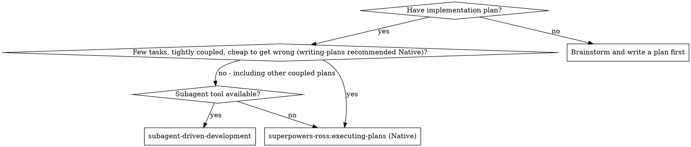
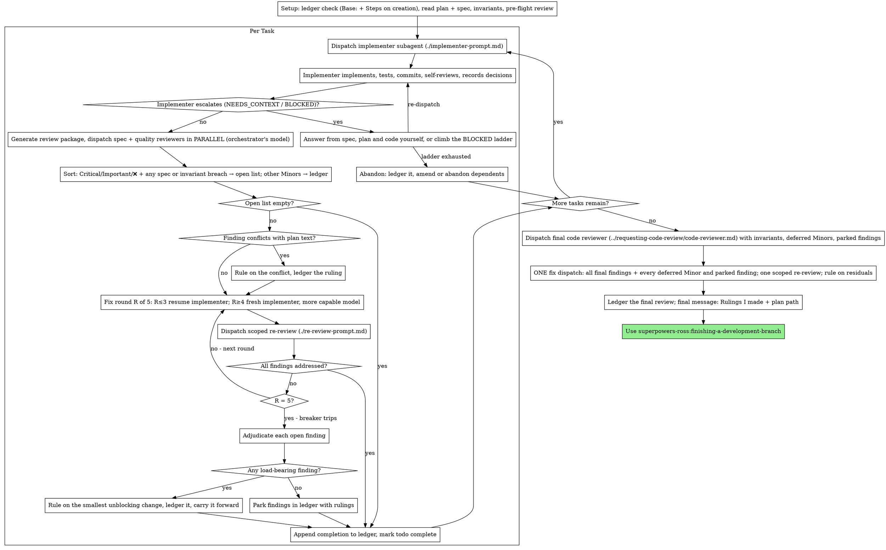

# Subagent-Driven Development

Execute plan by dispatching a fresh implementer subagent per task, two task reviewers in parallel after each (spec compliance, code quality), and a broad whole-branch review at the end.

**Why subagents:** You delegate tasks to specialized agents with isolated context. By precisely crafting their instructions and context, you ensure they stay focused and succeed at their task. They should never inherit your session's context or history — you construct exactly what they need. This also preserves your own context for coordination work.

**Core principle:** Fresh subagent per task + parallel spec and quality review + broad final review that fixes everything left = high quality, fast iteration

**Narration:** between tool calls, narrate at most one short line — the
ledger and the tool results carry the record.

**Continuous execution:** Do not pause to check in with your human partner between tasks. Execute all tasks from the plan without stopping, until all tasks are complete — nothing in this skill stops the run partway. "Should I continue?" prompts and progress summaries waste their time — they asked you to execute the plan, so execute it.

**Rulings, not stalls.** A running plan does not wait on a human. Conflicts,
ambiguities, plan defects, a cap you would have asked to exceed — decide
them. The spec is the binding authority, the plan is its argument, and your
judgment settles what neither answers. Record every decision in the ledger as
`Ruling: <what you decided> — <why> — <what it costs if wrong>`, and keep
going. A wrong ruling costs rework your human partner can see and undo; a
session parked on a question costs their whole day and buys nothing.

Some actions you never take, and the run goes on without them:

- **Unrecoverable actions** — anything not recoverable from git history:
  `git clean`, `git reset --hard`, deleting untracked or ignored data,
  touching data outside the repo.
- **Security-sensitive actions.**
- **Outward-facing actions** — a push, a merge, a publish.

Leave the action undone, ledger `Ruling: left for you — <action> — <why>`,
and continue. A task whose verification needs such an action is unverified:
ledger `Task <N>: Ruling: unverified — <the action its verification needs>`,
let its dependents proceed, and flag each of them in Rulings I made.

A plan broken past guessing still gets a ruling: take the most defensible
reading. If no reading gives a path that works, abandon the task (the last
rung of the BLOCKED ladder below). Items the plan leaves to the builder are
ruled and ledgered the same way.

## The Steps

Your FIRST action on invoking this skill, before reading the plan: write
this skill's step list into the ledger (see Setup for where). It keeps the
review and bookkeeping steps from being skipped under load, and it survives
compaction where your memory of this skill does not. Copy it exactly; do
not paraphrase or shorten it.

```
## Steps (subagent-driven-development)
Step 1. Resolve the workspace and check the ledger. Record Base and this step list.
Step 2. Read the plan and its spec. Run the pre-flight conflict scan. Make sure an invariants list exists, with a search anchor on every line.
Step 3. For each task: record BASE; dispatch the implementer; build the review package; run the spec and quality reviewers in parallel, both on the orchestrator's model; fix every Critical, Important and spec failure, and every finding that breaches a spec rule or invariant, then run a scoped re-review (5 rounds at most); log each remaining Minor as deferred; write the completion line.
Step 4. Run the final whole-branch review on opus with the invariants, the deferred Minors and the parked findings. One fix wave fixes everything it returns plus every deferred Minor and parked finding, then one scoped re-review. Anything left unfixed needs a ruling.
Step 5. List the rulings I made, then run finishing-a-development-branch.
```

Before each task and after any compaction, re-read the most recent
`## Steps` block in the ledger and check where you are against it.

## When to Use



**vs. Executing Plans (Native):**
- Fresh subagent per task (no context pollution) instead of one context doing every task
- Review after each task (spec compliance + code quality) instead of only at the end
- Costs a fresh context per task and per review; Native costs one context plus one final reviewer
- Both run in this session, share the same plan workspace and ledger, and never pause between tasks

## The Process



## Setup

The work happens on the current branch, in this checkout. Never switch
branches and never create one.

Conversation memory does not survive compaction. In real sessions,
controllers that lost their place have re-dispatched entire completed task
sequences — the single most expensive failure observed. Track progress in
a ledger file, not only in todos.

- Each plan owns a workspace: at skill start, run this skill's
  `bash scripts/sdd-workspace PLAN_FILE` — it prints the plan's git-ignored
  directory (under `<repo-root>/.superpowers/sdd/`), home to
  every artifact for THIS plan: ledger, briefs, reports, review packages.
  Another plan's directory is never yours to read or write.
- Check for this plan's ledger at `<workspace>/progress.md`. If its first
  line names your plan file, a task is DONE when the ledger has a
  `Task <N>: complete` line, a `Task <N>: Ruling: abandoned` line, or a
  `Task <N>: Ruling: unverified` line that ends with `(commits …)` — do
  not re-dispatch it; resume at the first task with none of these. The
  ledger is shared with superpowers-ross:executing-plans, so honour all
  three whichever executor wrote them. A task whose last line is a fix
  round is mid-loop: resume the loop at the next round. A ledger whose first line names a different plan file — or a stray
  ledger at the old flat path `.superpowers/sdd/progress.md` — is another
  plan's progress: leave it in place and start your own, fresh.
- Create the ledger with its identity as the first line:
  `# SDD ledger — plan: <plan file path>`, and the base as the second:
  `Base: <full sha>` — `git rev-parse HEAD` taken before any work. Write
  `Base:` once, when you create the ledger, before any task is dispatched;
  never rewrite it on resume. The final review and
  superpowers-ross:finishing-a-development-branch both read it.
- Straight after `Base:`, append the `## Steps (subagent-driven-development)`
  block from The Steps above. The first two lines stay the identity and
  `Base:` — finishing and resume read them by position. On resume, find the
  most recent `## Steps` block: if it is another executor's (the plan
  changed executors) or there is none (a ledger from before step lists),
  append this skill's block before anything else. The ledger stays
  append-only.
- The ledger is your recovery map: the commits it names exist in git even
  when your context no longer remembers creating them. After compaction,
  trust the ledger and `git log` over your own recollection.
- `git clean -fdx` will destroy the workspace (it's git-ignored scratch); if
  that happens, recover from `git log`.

Read the plan once, note its context and Global Constraints, and create a
todo per task. If the plan names a Spec, read that too: the spec is the
authority the plan argues from, and conflicts inside the plan resolve
against it. A plan with no reachable spec gets a ledger note saying so —
rulings made without one are provisional.

Before dispatching Task 1, scan the plan once for conflicts, writing down
what you checked as you check it:

- tasks that contradict each other or the plan's Global Constraints
- anything the plan explicitly mandates that the review rubric treats as a
  defect (a test that asserts nothing, verbatim duplication of a logic block)

The scan's output is a table, not a verdict. One row for every pair of tasks
that share a file or an interface: the two tasks, what one produces against
what the other consumes, and what you found. One row for every task: whether
its own text agrees with itself — the tests it specifies against the code it
specifies, the files it creates against the files it later touches. "The scan
is clean" without those rows is not a scan you ran.

Write the table to the ledger. Rule on everything you find before execution
begins — each finding against the plan text that mandates it — and record
each ruling in the ledger. If the scan is clean, proceed without comment.
Rule on each conflict it surfaces — the spec is the binding authority, the
plan is its argument — record the ruling beside its row, and dispatch
Task 1. The review loop remains the net for conflicts that only emerge from
implementation.


### Invariants

An invariant is a rule that must hold in code no task was asked to touch —
"a withheld restriction is invisible to its author", "links are built only
through `FrontendUrls`". Task briefs list the places the plan's author
thought of; invariants are how a reviewer finds the places nobody listed.

- The plan's `## Invariants` section is the list. Each line names the rule,
  the kinds of code path it governs, and at least one search anchor — a
  symbol, pattern or file a grep finds. During the pre-flight scan, check
  every line has an anchor; where one is missing, find one in the codebase,
  add it to `<workspace>/invariants.md` beside a copy of the list, and use
  that file from then on.
- A plan with no Invariants section (an older plan): write the list from
  the spec and the codebase's conventions (including the project's
  CLAUDE.md) into `<workspace>/invariants.md`, ledger
  `Setup: invariants written by the controller (<count>)`, and print the
  list to your human partner in your next message, one line each. Do not
  wait for a reply. With no reachable spec, write it from the plan alone.
- `None` in the plan means there is nothing to search; the spec reviewer
  still checks the diff against the spec.

## Model Selection

**Always pass `model` explicitly when dispatching a subagent** — `haiku`,
`sonnet` or `opus`. An omitted model inherits your session's model — often
the most capable and most expensive — which silently defeats this section.

The tier follows how much judgment the task's steps leave open — never how
many files the task touches or how large it is. A rename swept across twenty
files leaves nothing to decide; a one-function change to a lock protocol
leaves a great deal.

**Implementer:**
- `sonnet` by default.
- `haiku` when the steps leave essentially nothing to decide: pinned
  signatures with pinned tests and obvious bodies, config or rename sweeps,
  batched same-shape edits.
- `opus` for a design-heavy task, or after a `sonnet` implementer returns
  BLOCKED.

**Spec and quality reviewers:** the orchestrator's own model — `opus` when
this session runs on Opus, `sonnet` when it runs on Sonnet — for both, on
every task, whatever tier the implementer got. Pass it explicitly.

**Scoped re-reviews:** the orchestrator's own model when the round carried a
spec or invariant finding (the re-review re-runs the invariant search);
otherwise `haiku` or `sonnet`, scaled to the fix diff.

**Fix-loop escalation (rounds 4-5):** at least one tier above the
implementer that got stuck.

**Final whole-branch review:** `opus`.

**Turn count beats token price.** Wall-clock and context cost scale with how
many turns a subagent takes, and the cheapest models routinely take 2-3× the
turns on work that needs judgment — costing more overall. That is why
`haiku` is kept for steps that leave nothing to decide.

## The Task Loop

**Batch small same-shape work.** This is a fallback for plans that still
contain small same-shape tasks; a plan written as one task per outcome has
already folded them together. When the plan lists several tasks that are
each a small, independent edit of the same kind — the same one-line fix,
constant change, or field addition repeated across files — do not dispatch
one subagent per task. Compose ONE dispatch brief listing every file and
its change, send the whole batch to a single subagent, and review its diff
as one unit. Reserve one-dispatch-per-task for work that needs its own
judgment, its own tests, or its own review surface. Ledger a batch so the
ranges still chain: the first task in it gets the completion line with
the batch's range, `(commits <a7>..<b7>, ...)`, and every other task in it
gets `(commits <b7>..<b7>, batched with Task <first>)`.

Everything you paste into a dispatch prompt — and everything a subagent
prints back — stays resident in your context for the rest of the session
and is re-read on every later turn. Hand artifacts over as files.

**Waiting on dispatched subagents:** never poll a wait interface with
short timeouts, and never sit in one silent, open-ended wait either.
While you have local work — ledger updates, packaging the next review,
reading reports — keep working; child results arrive on their own.
When you are genuinely idle, wait in bounded stretches (five to ten
minutes, where your platform allows), and between stretches post one
line of status and reconcile your live children: list them, and chase
any that finished without reporting. A bounded stretch keeps nearly
all of a long wait's efficiency while guaranteeing a stuck or lost
child is noticed within minutes, not at the end of the session.

### 1. Dispatch the implementer

Record BASE (`git rev-parse HEAD`) before dispatching — the review package
and fix-round diffs need it.

- **Task brief:** before dispatching an implementer, run this skill's
  `bash scripts/task-brief PLAN_FILE N` — it extracts the task's full text to a
  uniquely named file and prints the path. Compose the dispatch so the
  brief stays the single source of
  requirements. Your dispatch should contain: (1) one line on where this
  task fits in the project; (2) the brief path, introduced as "read this
  first — it is your requirements, with the exact values to use verbatim";
  (3) interfaces and decisions from earlier tasks that the brief cannot
  know; (4) your resolution of any ambiguity you noticed in the brief;
  (5) the report-file path and report contract. Exact values (numbers,
  magic strings, signatures, test cases) appear only in the brief. Never
  make a subagent read the whole plan file.
- **Report file:** name the implementer's report file after the brief
  (brief `…/task-N-brief.md` → report `…/task-N-report.md`) and put it in
  the dispatch prompt. The implementer writes the full report there and
  returns only status, commits, a one-line test summary, and concerns.
- A dispatch prompt describes one task, not the session's history. Do not
  paste accumulated prior-task summaries ("state after Tasks 1-3") into
  later dispatches — a real session's dispatch hit 42k chars of which 99%
  was pasted history. A fresh subagent needs its task, the interfaces it
  touches, and the global constraints. Nothing else.
- The dispatch carries the no-subagents contract (it is in the
  implementer template): the implementer never dispatches subagents —
  not helpers, and never a reviewer. Review arrives from you, after the
  report. In real sessions, every reviewer a worker spawned duplicated
  the task review the controller dispatched anyway — a full extra
  review seat per task.
- If an earlier task parked a finding in the area this task touches, carry
  a pointer to that ledger entry in the dispatch.
- Record the implementer's agent identity from the dispatch result —
  fix-loop rounds 1-3 resume this agent.
- Never dispatch multiple implementation subagents in parallel (conflicts).

Template: [implementer-prompt.md](implementer-prompt.md)

### 2. Handle the report

Implementer subagents report one of four statuses. Handle each appropriately:

**DONE:** Generate the review package (`bash scripts/review-package PLAN_FILE BASE HEAD`, from this skill's directory — it prints the unique file path it wrote and its line count; BASE is the commit you recorded before dispatching the implementer — never `HEAD~1`, which silently drops all but the last commit of a multi-commit task), then dispatch both task reviewers with the printed path.

Every report carries a Decisions section: the calls the implementer made
where the brief left them open. They are reviewed with the rest of the
task. When a decision settles something the plan explicitly left to the
builder, ledger it as `Task <N>: Ruling: <decision> — <why> — <what it
costs if wrong>`.

**DONE_WITH_CONCERNS:** The implementer completed the work but flagged doubts. Read the concerns before proceeding. If the concerns are about correctness or scope, address them before review. If they're observations (e.g., "this file is getting large"), note them and proceed to review.

**NEEDS_CONTEXT:** The implementer needs information that wasn't provided. Find it yourself in the spec, the plan and the code, and re-dispatch with it. Where none of them answers it, rule on the most defensible answer, ledger the ruling, and carry it in the dispatch. If the only answer is an external fact nobody gave you — a credential, an account, a third-party service the plan does not name — never invent one: go to rung 3 of the BLOCKED ladder.

**BLOCKED:** The implementer cannot complete the task. Climb this ladder in order; skip a rung only when it plainly cannot help (more context for a blocker that is not about context):
1. **More context, same model** — answer the blocker from the spec, plan and code, and re-dispatch.
2. **One model tier up** — re-dispatch on the next tier (`haiku` → `sonnet` → `opus`).
3. **Amend the task once** — write the amendment into the task's brief file, ledger it as `Task <N>: Ruling: amended — <what changed> — <why> — <what it costs if wrong>`, and re-dispatch. Never edit the plan file and never renumber tasks. A task gets one amendment. `task-brief` rewrites the brief from the plan, so on resume re-apply any `Task <N>: Ruling: amended` line to the regenerated brief before dispatching.
4. **Abandon** — if the task left uncommitted changes, commit them as `wip: abandoned Task <N>` (never reset or clean them away). Then ledger `Task <N>: Ruling: abandoned — <why> — dependents: <each amended to stand alone, or abandoned too>`, ending the line with ` (commits <a7>..<b7>)` when the task left commits — from the BASE you recorded before dispatching its implementer to HEAD, so the range covers the `wip:` commit. Before dispatching each dependent, do what that line says: amend it once to stand alone (rung 3's rules), or abandon it in turn.

**Never** ignore an escalation or force the same model to retry without changes. If the implementer said it's stuck, something needs to change.

If the implementer asks questions — before starting or mid-task — answer
them yourself from the spec, the plan and the code, clearly and completely,
and provide additional context if needed. Never relay an implementer's
question to your human partner: the run does not wait on a human. A
question none of the three answers gets a ruling, ledgered and carried in
the dispatch.

### 3. Review the task — two reviewers, in parallel

Per-task reviews are task-scoped gates. The broad review happens once, at the
final whole-branch review. Never skip either task reviewer. Implementer
self-review never replaces the task review; both are needed.

Dispatch BOTH reviewers in one message — they are read-only, so parallel
dispatch is safe, and neither waits on the other:

- **Spec reviewer** ([spec-reviewer-prompt.md](spec-reviewer-prompt.md)) —
  owns the ✅/❌/⚠️ Spec Compliance verdict. The spec is its authority over
  the brief, and it searches the codebase, including unchanged code, for
  every path the invariants this task touches govern.
- **Quality reviewer** ([code-quality-reviewer-prompt.md](code-quality-reviewer-prompt.md))
  — owns the Task quality verdict.

Never sort findings until both reports are in, and never accept a spec
report without per-invariant search evidence (search terms, hit count,
files read) for every invariant you named — re-dispatch it once, as with a
missing read-through line.

- Hand the reviewers their diff as a file: run this skill's
  `bash scripts/review-package PLAN_FILE BASE HEAD` and pass the reviewer the file path
  it prints (or, without bash: `git log --oneline`, `git diff --stat`,
  and `git diff -U10` for the range, redirected to one uniquely named
  file, with `# Review package: BASE..HEAD (<L> lines)` as its first
  line). Both reviewers get the same path. The output never enters your own context, and each reviewer reads
  the commit list, stat summary, and full diff with context from one file,
  in ~1,000-line chunks. Use the BASE you recorded before dispatching the implementer —
  never `HEAD~1`, which silently truncates multi-commit tasks. Never
  dispatch a reviewer without a diff file.
- **Reviewer inputs:** both reviewers get the brief file, the report file,
  the review package, and the global constraints that bind the task. The
  spec reviewer also gets the spec path, the invariants list verbatim, and
  the names of the invariants whose governed paths this task's outcome
  touches. Name them generously: an invariant you leave off is one the
  reviewer may not search.
- **Read-through check:** every reviewer report — task review, re-review,
  final review — states "read through line L". A report without that
  statement, or with an L short of the package's line count, is
  re-dispatched once. If the second report also lacks it, rule on what the
  review covered (accept it, or treat the unread part as unreviewed) and
  ledger the ruling.
- The global-constraints block you hand the reviewers is their attention
  lens. Copy the binding requirements verbatim from the plan's Global
  Constraints section or the spec: exact values, exact formats, and the
  stated relationships between components ("same layout as X", "matches
  Y"). The reviewer templates already carry the process rules (YAGNI,
  test hygiene, review method) — the constraints block is for what THIS
  project's spec demands.
- Do not add open-ended directives like "check all uses" or "run race tests
  if useful" without a concrete, task-specific reason. The invariants are
  that reason, written down: the spec reviewer's search is scoped to them.
- Do not ask a reviewer to re-run tests the implementer already ran on the
  same code — the implementer's report carries the test evidence
- Do not pre-judge findings for the reviewer — never instruct a reviewer to
  ignore or not flag a specific issue. If you believe a finding would be a
  false positive, let the reviewer raise it and adjudicate it in the review
  loop. If the prompt you are writing contains "do not flag," "don't treat X
  as a defect," "at most Minor," or "the plan chose" — stop: you are
  pre-judging, usually to spare yourself a review loop.
The spec reviewer may report "⚠️ Cannot verify from diff" items — requirements
that live in unchanged code or span tasks. These do not block the rest of the
review, but you must resolve each one yourself before marking the task
complete: you hold the plan and cross-task context the reviewer
lacks. If you confirm an item is a real gap, treat it as a failed spec
review — it enters the fix loop with the other findings.

Templates: [spec-reviewer-prompt.md](spec-reviewer-prompt.md),
[code-quality-reviewer-prompt.md](code-quality-reviewer-prompt.md)

### 4. The fix loop

Once both reports are in, sort every finding into ONE open list:

- every spec ❌ (including invariant breaches, whether this task caused
  them or the code predates the branch), every Critical and Important from
  either reviewer, and every ⚠️ item you confirmed as a real gap;
- any finding of any grade — a quality Minor included — that breaches a
  spec rule or an invariant. A reviewer that graded a spec breach Minor
  graded its size, not its effect. Ledger
  `Task <N>: Ruling: regraded — <finding> — breaches <rule>`. Re-grading
  only ever moves a finding up.

The loop triggers when the open list is not empty. Before it starts, three
routes leave it:

- **A breach in a path the plan gives to a later task** goes to that task:
  ledger `Task <N>: Ruling: deferred to Task <M> — <finding> — <why that
  task owns it>` and carry the finding in Task M's dispatch. Only an
  explicit plan assignment qualifies; "a later task is near there" does
  not.
- **Remaining Minors** are deferred, not dropped: ledger each as
  `Task <N>: minor (deferred): <one-liner>`. The final fix wave fixes every
  one of them (see Final Review). Deferred means "fixed in the final wave",
  never "maybe later" — nothing after the final wave will pick them up.
- A finding labeled plan-mandated — or any finding that conflicts with
  what the plan's text requires — is yours to rule on: weigh the finding
  against the plan text, decide with the spec as the binding authority, and
  ledger the ruling before you act on it. Do not dismiss the finding because
  the plan mandates it, and do not dispatch a fix that contradicts the plan
  without a recorded ruling.
Everything else enters the loop. A fix round is one fix dispatch carrying
the whole open list, from both reviewers, plus one scoped re-review. Five
rounds maximum per task:

**Rounds 1-3 — resume the original implementer.** Send it the open findings
verbatim. Its context is intact: it knows the task, the code, and its own
choices. If your harness cannot send another message to a live subagent,
dispatch a fresh implementer carrying the brief path, the report-file path,
and the findings — the report file is the persistent memory either way.

**Rounds 4-5 — dispatch a fresh implementer on a more capable model** (per
Model Selection), with the brief path, the report-file path, the open
findings, and this framing: "A prior implementer attempted this task
[N] times; you own it now. Read the report file for what was tried." A loop
that survives three resumes usually means the implementer cannot see its
own problem — fresh eyes and a capability bump in one move.

**Every round, either way:** the implementer fixes, re-runs the tests
covering the amended code, appends its fix report to the same report file,
and returns the short contract. Before dispatching the re-review, confirm
the fix report contains the covering tests, the command run, and the
output; dispatch the re-review once all three are present. Name the
covering test files in the fix message — a one-line fix does not need the
whole suite.

**The re-review is scoped.** Run `bash scripts/review-package PLAN_FILE FIX_BASE HEAD`
where FIX_BASE is the head the previous review saw, and dispatch
[re-review-prompt.md](re-review-prompt.md) with the open list, the
brief, the report file, and the printed diff path. When the round carried a
spec or invariant finding, also pass each breached invariant: the
re-reviewer re-runs its search over the codebase, not only the fix diff, and
runs on the orchestrator's model (see Model Selection). The re-reviewer
verdicts each finding ADDRESSED or NOT ADDRESSED and flags new breakage in
the fix diff. New Critical/Important breakage in the fix diff joins the open
findings list. Out-of-scope observations go to the ledger as deferred
minors — they never extend the loop.

**After each round,** append to the ledger:
`Task <N>: fix round <R>/5 (<X> addressed, <Y> open — <finding one-liners>; commits <a7>..<b7>)`
— the round's own range, FIX_BASE to HEAD. It sits inside the task's
completion range, so the chain finishing checks skips it: only completion,
abandoned, unverified and `Final review: fixes` ranges are chained.

Never fix findings yourself in the controller session — your context stays
clean for coordination, and controller fixes skip review.

**The breaker.** When round 5's re-review still leaves findings open, stop
dispatching. Adjudicate each open finding yourself — you hold the plan and
the cross-task context the reviewer lacks:

- **The reviewer is wrong, or the point is contestable:** park it —
  `Task <N>: parked — <finding> — Ruling: <why the code stands>`. The final
  review sees both sides.
- **Real, but nothing downstream builds on it:** park it the same way, with
  a ruling that says it's real and deferred.
- **Real and load-bearing** — a later task builds on it, or it reveals a
  plan defect: rule on the smallest change that unblocks the dependent work,
  ledger it as `Task <N>: Ruling: <finding> — <what you decided and why>`,
  and carry it into the next task's dispatch. Parking a structural failure
  silently lets every dependent task build on it. When no change unblocks
  the dependent work, the defect is past guessing: amend each dependent
  once to stand alone, or abandon it, as the BLOCKED ladder's last rung
  does.

Adjudicate only at the cap. Adjudicating earlier to end a loop is
pre-judging with a different name. Every adjudication is a ledger entry —
a silent discard is forbidden.

### 5. Complete the task

When the review comes back clean — or every open finding is parked with a
ruling at the cap — append the completion line to the ledger in the same
message as your other bookkeeping:

- `Task <N>: complete (commits <base7>..<head7>, review clean)`
- `Task <N>: complete (commits <base7>..<head7>, <K> parked)` after a
  tripped breaker
- `Task <N>: complete (commits <base7>..<head7>, unverified)` when its
  verification needs an action you do not take

Then mark the todo complete and move on. Never move to the next task while
the review has open Critical/Important issues that are neither fixed nor
parked-with-ruling at the cap.

## Final Review

The final whole-branch review gets a package too: run
`bash scripts/review-package PLAN_FILE BASE HEAD` (BASE = the ledger's
`Base:` line, the commit HEAD was on before any task ran) and include the
printed path in the final review dispatch, so the final reviewer reads
one file instead of re-deriving the branch diff with git commands. Dispatch
on `opus` (see Model Selection), using
superpowers-ross:requesting-code-review's
[code-reviewer.md](../requesting-code-review/code-reviewer.md). Give it the
invariants list verbatim — it checks each across the whole codebase and
reports its search evidence — and the ledger's `minor (deferred)` and
`parked` lines as work to be fixed, not triaged: "these get fixed; flag any
you believe are wrong, with why".

Dispatch ONE fix subagent with everything left: the final reviewer's
findings at every grade, Minor included, plus every deferred Minor and
every parked finding it did not show to be wrong — not one fixer per
finding.
Per-finding fixers each rebuild context and re-run suites; a real
session's final-review fix wave cost more than all its tasks combined.
Then run exactly one scoped re-review of the fix wave
(`bash scripts/review-package PLAN_FILE FIX_BASE HEAD` over the fix range,
[re-review-prompt.md](re-review-prompt.md)).
There is no second fix wave. Every item the wave did not fix — the
re-review says NOT ADDRESSED, or you excluded it before dispatch — gets a
ruling:
`Final: Ruling: not fixed — <finding> — <wrong: why | not a code change | fix failed: what was tried> — <cost if wrong>`.
"Not worth it", "polish" and "can wait" are not reasons: nothing after this
wave will pick the item up. Residual load-bearing findings go at the top of
Rulings I made.

Then ledger the outcome: `Final review: fixes (commits <a7>..<b7>)` over
the fix wave's range, or `Final review: clean` when there was nothing to
fix.

## Finish

Collect every ledger line containing `Ruling:` — preflight rulings, parked
findings, breaker adjudications, amendments, all of them — into your final
message under "Rulings I made". List these first: abandoned tasks and the
dependents they took with them; "left for you" actions; unverified tasks
and the dependents flagged with them; residual load-bearing findings from
the final review. Then every other ruling, in the order you made them,
each with what it costs if wrong. The list is exhaustive: if the ledger
holds a ruling, the list holds it. That list is the only place the decisions you
took on your human partner's behalf reach them — they read it and rework
whatever you got wrong. A ruling that dies with the workspace was a decision
made in secret.

Put the plan file path in the same message. Do not delete this plan's
workspace: superpowers-ross:finishing-a-development-branch reads `Base:`
and the chained commit ranges from its ledger, and deletes it when it is done.
Sibling directories belong to other plans; leave them alone.

Use superpowers-ross:finishing-a-development-branch.

## Common Rationalizations

| Excuse | Reality |
|--------|---------|
| "Close enough on spec compliance" | Reviewer found spec gaps = not done. Fix or hit the cap and adjudicate — those are the only exits. |
| "I'll fix it myself, dispatching is overhead" | Controller fixes pollute your context and skip review. Resume the implementer. |
| "One more round will converge" | Past the cap, rounds don't converge — the failure is structural. Adjudicate and route. |
| "The reviewer will just find something new anyway" | Scoped re-reviews verify fixes; they cannot wander. New findings on untouched code go to the ledger, not the loop. |
| "This finding is obviously wrong, I'll drop it" | You adjudicate only at the cap, and every ruling is a ledger entry. Silent discards are forbidden. |
| "The fix was small, skip the re-review" | Unreviewed fixes are how regressions land. Every round ends with a scoped re-review. |
| "Reviews slow the loop down" | The loop without reviews is just unverified churn. Reviews are the loop's brakes and steering. |
| "Ledger bookkeeping is overhead" | The ledger is what survives compaction. Controllers without one have re-dispatched entire completed task sequences. |
| "My human partner would know the answer, I'll just ask" | The run does not wait on a human. Answer from the spec, plan and code; where they are silent, rule and ledger it. |
| "The implementer spawned its own reviewer — free extra assurance" | It's a duplicate seat reviewing the same diff; the task review is the gate. A worker-spawned reviewer is a defect to flag, not rigor. |
| "It's only Minor, it can wait" | It waits for the final wave, and the final wave fixes it. Nothing after that wave picks it up — "later" is never. |
| "The reviewer graded this spec breach Minor" | Grade is size; a spec or invariant breach is a failure at any size. Re-grade it into the open list. |
| "That breach predates this branch, not my task" | An invariant breach the search finds is this task's ❌. The run leaves the rule holding. |
| "I know the steps, no need to write them to the ledger" | The step list is for after compaction, when you don't. Write it first, re-read it before each task. |
| "One reviewer can cover spec and quality" | Two focused reads find what one split read misses. Dispatch both, in parallel. |
| "The reviewer said it checked the invariant" | No search terms, hit count and files read means no check. Send it back. |

## Example Workflow

```
You: I'm using Subagent-Driven Development to execute this plan.

[Read plan file once: docs/superpowers/plans/feature-plan.md]
[Resolve workspace: bash scripts/sdd-workspace docs/superpowers/plans/feature-plan.md — no ledger inside, fresh start]
[Create ledger: plan line, Base: <git rev-parse HEAD>, then the ## Steps block copied verbatim]
[Plan's Invariants: 2 lines, both anchored — "hooks only under ~/.config/superpowers/hooks (anchor: HOOK_DIR)", ...]
[Create todos for all tasks]

Task 1: Hook installation script

[Run task-brief for Task 1; dispatch implementer with brief + report paths + context]

Implementer: "NEEDS_CONTEXT: should the hook be installed at user or system level?"

You: [Spec says installs never need root — answer from it, no question to the user]
  [Re-dispatch: "User level (~/.config/superpowers/hooks/), per the spec's no-root rule"]

Implementer: [Later]
  - Implemented install-hook command
  - Added tests, 5/5 passing
  - Self-review: Found I missed --force flag, added it
  - Decisions: existing hook file is backed up, not overwritten (brief silent)
  - Committed

[Run review-package PLAN_FILE BASE HEAD; dispatch spec + quality reviewers in parallel, both on the session's model]
Spec reviewer: Read through line 212 of 212. Spec ✅. Invariants: hook dir —
  searched HOOK_DIR, "hooks/" (6 hits; files read: install.js, paths.js) ✅ holds.
Quality reviewer: Read through line 212 of 212. Strengths: good coverage.
  Minor: install.js:30 error message omits the path. Task quality: Approved.
[Ledger: Task 1: minor (deferred): install.js:30 error message omits the path]

[Ledger: Task 1: complete (commits a1b2c3d..d4e5f6a, review clean)]

Task 2: Recovery modes

[Run task-brief for Task 2; dispatch implementer with brief + report paths + context]

Implementer: [No questions]
  - Added verify/repair modes
  - 8/8 tests passing
  - Committed a9b8c7d

[Run review-package PLAN_FILE BASE HEAD; dispatch both reviewers in parallel]
Spec reviewer: Spec ❌:
  - Missing: Progress reporting (spec says "report every 100 items")
Quality reviewer: Issues (Important): Magic number (100)

[Fix round 1: resume the implementer with the open list — both findings]
Implementer: Added progress reporting, extracted PROGRESS_INTERVAL constant.
  Re-ran test/recovery.test.js — 10/10 passing. Fix report appended.

[Run review-package PLAN_FILE a9b8c7d HEAD (FIX_BASE); dispatch scoped re-review]
Re-reviewer: Read through line 96 of 96.
  Missing progress reporting — ADDRESSED (src/recovery.js:41).
  Magic number — ADDRESSED (src/recovery.js:7). New breakage: none.
  Verdict: all findings addressed.

[Ledger: Task 2: fix round 1/5 (2 addressed, 0 open; commits a9b8c7d..b7c8d9e)]
[Ledger: Task 2: complete (commits d4e5f6a..b7c8d9e, review clean)]

...

[After all tasks]
[Run review-package PLAN_FILE BASE HEAD, BASE from the ledger's Base: line; dispatch final code-reviewer on opus with the invariants and the deferred Minors]
Final reviewer: Read through line 1843 of 1843. All requirements met.
  Invariants hold (search evidence given). Deferred Minor install.js:30 — still present.

[ONE fix dispatch: the deferred Minor; scoped re-review: ADDRESSED]
[Ledger: Final review: fixes (commits c9d0e1f..f2a3b4c)]
[Final message: Rulings I made, plan path — workspace left for finishing]

Done! Using superpowers-ross:finishing-a-development-branch.
```
