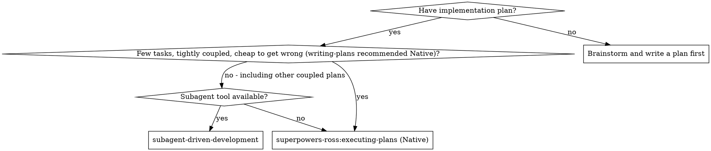
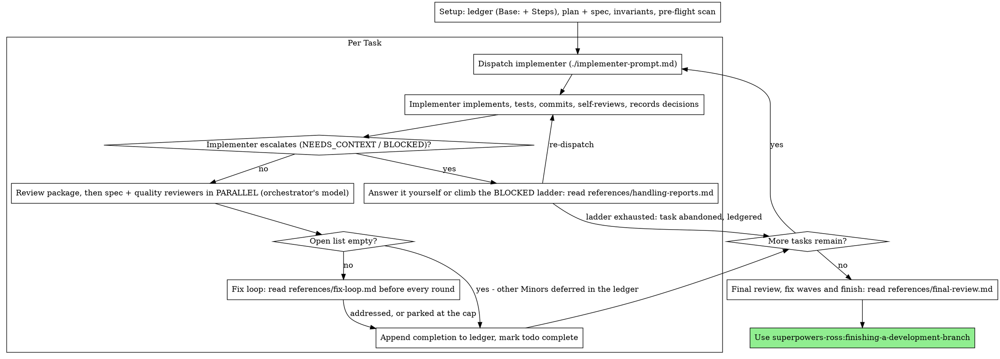

# Subagent-Driven Development

Execute plan by dispatching a fresh implementer subagent per task, two task reviewers in parallel after each (spec compliance, code quality), and a broad whole-branch review at the end.

**Why subagents:** You delegate tasks to specialized agents with isolated context. By precisely crafting their instructions and context, you ensure they stay focused and succeed at their task. They should never inherit your session's context or history — you construct exactly what they need. This also preserves your own context for coordination work.

**Core principle:** Fresh subagent per task + parallel spec and quality review + broad final review that fixes everything left = high quality, fast iteration

**Narration:** between tool calls, narrate at most one short line — the ledger and the tool results carry the record.

**Continuous execution:** Do not pause to check in with your human partner between tasks. Execute all tasks from the plan without stopping, until all tasks are complete — nothing in this skill stops the run partway. "Should I continue?" prompts and progress summaries waste their time — they asked you to execute the plan, so execute it.

**Rulings, not stalls.** A running plan does not wait on a human. Conflicts, ambiguities, plan defects, a cap you would have asked to exceed — decide them. The spec is the binding authority, the plan is its argument, and your judgment settles what neither answers. Record every decision in the ledger as `Ruling: <what you decided> — <why> — <what it costs if wrong>`, and keep going. A wrong ruling costs rework your human partner can see and undo; a session parked on a question costs their whole day and buys nothing.

Some actions you never take, and the run goes on without them:

- **Unrecoverable actions** — anything not recoverable from git history: `git clean`, `git reset --hard`, deleting untracked or ignored data, touching data outside the repo.
- **Security-sensitive actions.**
- **Outward-facing actions** — a push, a merge, a publish.

Leave the action undone, ledger `Ruling: left for you — <action> — <why>`, and continue. A task whose verification needs such an action is unverified: ledger `Task <N>: Ruling: unverified — <the action its verification needs>`, let its dependents proceed, and flag each of them in Rulings I made.

A plan broken past guessing still gets a ruling: take the most defensible reading. If no reading gives a path that works, abandon the task (the last rung of the BLOCKED ladder, in [references/handling-reports.md](references/handling-reports.md)). Items the plan leaves to the builder are ruled and ledgered the same way.

## The Steps

Your FIRST action on invoking this skill, before reading the plan: write this skill's step list into the ledger (see Setup for where). It keeps the review and bookkeeping steps from being skipped under load, and it survives compaction where your memory of this skill does not. Copy it exactly; do not paraphrase or shorten it.

```
## Steps (subagent-driven-development)
Step 1. Resolve the workspace and check the ledger. Record Base and this step list.
Step 2. Read the plan and its spec. Run the pre-flight conflict scan. Make sure an invariants list exists, with a search anchor on every line.
Step 3. For each task: record BASE; dispatch the implementer; build the review package; run the spec and quality reviewers in parallel, both on the orchestrator's model; fix every Critical, Important and spec failure, and every finding that breaches a spec rule or invariant, then run a scoped re-review (5 rounds at most); log each remaining Minor as deferred; write the completion line.
Step 4. Run the final whole-branch review on opus with the invariants, the deferred Minors and the parked findings. A fix wave fixes everything it returns plus every deferred Minor and parked finding, then a scoped re-review; whatever the re-review leaves open, including breakage the wave made, goes to the next wave (3 waves at most). Anything left unfixed needs a ruling.
Step 5. List the rulings I made, then run finishing-a-development-branch.
```

Before each task and after any compaction, re-read the most recent `## Steps` block in the ledger and check where you are against it. Then re-read the `references/` file this skill points to for that step: compaction took it too.

## When to Use



## The Process



## Setup

The work happens on the current branch, in this checkout. Never switch branches and never create one.

Conversation memory does not survive compaction. In real sessions, controllers that lost their place have re-dispatched entire completed task sequences — the single most expensive failure observed. Track progress in a ledger file, not only in todos.

- Each plan owns a workspace: at skill start, run this skill's `bash scripts/sdd-workspace PLAN_FILE` by its absolute path, from the working tree you're executing in — it prints the plan's git-ignored directory (under `<repo-root>/.superpowers/sdd/`), home to every artifact for THIS plan: ledger, briefs, reports, review packages. Another plan's directory is never yours to read or write.
- Check for this plan's ledger at `<workspace>/progress.md`. If one exists, read [references/resuming.md](references/resuming.md) before anything else: it says whose ledger it is, which tasks are done, and where to resume.
- Create the ledger with its identity as the first line: `# SDD ledger — plan: <plan file path>`, and the base as the second: `Base: <full sha>` — `git rev-parse HEAD` taken before any work. Write `Base:` once, when you create the ledger, before any task is dispatched; never rewrite it on resume. The final review and superpowers-ross:finishing-a-development-branch both read it.
- Straight after `Base:`, append the `## Steps (subagent-driven-development)` block from The Steps above. The first two lines stay the identity and `Base:` — finishing and resume read them by position. The ledger stays append-only.
- The ledger is your recovery map: the commits it names exist in git even when your context no longer remembers creating them. After compaction, trust the ledger and `git log` over your own recollection.

Read the plan once, note its context and Global Constraints, and create a todo per task. If the plan names a Spec, read that too: the spec is the authority the plan argues from, and conflicts inside the plan resolve against it. A plan with no reachable spec gets a ledger note saying so — rulings made without one are provisional.

Before dispatching Task 1, read [references/preflight.md](references/preflight.md) and run the conflict scan it describes. Its table and rulings go in the ledger.

**Invariants.** During the pre-flight scan, read [references/plan-invariants.md](references/plan-invariants.md) and follow it: every invariant needs a search anchor, and a plan without an Invariants section gets a list written to `<workspace>/invariants.md`.

## Model Selection

**Always pass `model` explicitly when dispatching a subagent** — `haiku`, `sonnet` or `opus`. An omitted model inherits your session's model — often the most capable and most expensive — which silently defeats this section.

Before your first dispatch, and again after any compaction, read [references/model-selection.md](references/model-selection.md): it sets the tier for every role. In short: implementers on `sonnet` by default, both task reviewers on the orchestrator's own model, the final whole-branch review on `opus`.

## The Task Loop

**Small same-shape work:** when the plan lists several small edits of the same kind across files, read [references/batching.md](references/batching.md) before dispatching them.

Everything you paste into a dispatch prompt — and everything a subagent prints back — stays resident in your context for the rest of the session and is re-read on every later turn. Hand artifacts over as files.

### 1. Dispatch the implementer

Record BASE (`git rev-parse HEAD`) before dispatching — the review package and fix-round diffs need it.

- **Task brief:** before dispatching an implementer, run this skill's `bash scripts/task-brief PLAN_FILE N` by its absolute path, from the working tree you're executing in — it extracts the task's full text to a uniquely named file and prints the path. Never make a subagent read the whole plan file.
- **Compose the dispatch** as [references/dispatching.md](references/dispatching.md) says. Read it before your first dispatch, and again after any compaction: what a dispatch contains, the report-file contract, and how to wait on a subagent.
- Record the implementer's agent identity from the dispatch result — fix-loop rounds 1-3 resume this agent.
- Never dispatch multiple implementation subagents in parallel (conflicts).

Template: [implementer-prompt.md](implementer-prompt.md)

### 2. Handle the report

Implementer subagents report one of four statuses. Handle each appropriately:

**DONE:** Generate the review package (`bash scripts/review-package PLAN_FILE BASE HEAD` by its absolute path, from the working tree you're executing in — it prints the unique file path it wrote and its line count; BASE is the commit you recorded before dispatching the implementer — never `HEAD~1`, which silently drops all but the last commit of a multi-commit task), then dispatch both task reviewers with the printed path.

Every report carries a Decisions section: the calls the implementer made where the brief left them open. They are reviewed with the rest of the task. When a decision settles something the plan explicitly left to the builder, ledger it as `Task <N>: Ruling: <decision> — <why> — <what it costs if wrong>`.

**Any other status** (DONE_WITH_CONCERNS, NEEDS_CONTEXT, BLOCKED): read [references/handling-reports.md](references/handling-reports.md) and follow it, every time you get one. It holds the BLOCKED ladder, which ends in amending the task once and then abandoning it. An implementer's question is handled the same way: answer it yourself from the spec, the plan and the code, or rule on it. Never relay it to your human partner.

### 3. Review the task — two reviewers, in parallel

Per-task reviews are task-scoped gates. The broad review happens once, at the final whole-branch review. Never skip either task reviewer. Implementer self-review never replaces the task review; both are needed.

Dispatch BOTH reviewers in one message — they are read-only, so parallel dispatch is safe, and neither waits on the other:

- **Spec reviewer** ([spec-reviewer-prompt.md](spec-reviewer-prompt.md)) — owns the ✅/❌/⚠️ Spec Compliance verdict. The spec is its authority over the brief, and it searches the codebase, including unchanged code, for every path the invariants this task touches govern.
- **Quality reviewer** ([code-quality-reviewer-prompt.md](code-quality-reviewer-prompt.md)) — owns the Task quality verdict.

Never sort findings until both reports are in, and never accept a spec report without per-invariant search evidence (search terms, hit count, files read) for every invariant you named — re-dispatch it once, as with a missing read-through line.

Before dispatching the reviewers for each task, read [references/task-review.md](references/task-review.md), even if you read it earlier in this session: the review package, what each reviewer is handed, the read-through check, and what never goes in a reviewer's prompt.

If the spec reviewer reports "⚠️ Cannot verify from diff" items, read [references/cannot-verify.md](references/cannot-verify.md) before you mark the task complete.

### 4. The fix loop

Once both reports are in, sort every finding into ONE open list. It holds every spec ❌, every Critical and Important from either reviewer, every ⚠️ item you confirmed as a real gap, and any finding of any grade that breaches a spec rule or an invariant, whether this task caused the breach or the code predates the branch.

The loop triggers when the open list is not empty. When it triggers, read [references/fix-loop.md](references/fix-loop.md) and follow it. Read it again before every round, even if you read it earlier in this session: it holds the sorting rules, the routes that leave the loop, the round cap, the breaker, and the ledger line each round writes, and your memory of it does not survive compaction.

**Remaining Minors** are deferred, not dropped: ledger each as `Task <N>: minor (deferred): <one-liner>`. The final fix waves fix every one of them. Deferred means "fixed in the final waves", never "maybe later" — nothing after the final waves will pick them up.

### 5. Complete the task

When the review comes back clean — or every open finding is parked with a ruling at the cap — append the completion line to the ledger in the same message as your other bookkeeping:

- `Task <N>: complete (commits <base7>..<head7>, review clean)`
- `Task <N>: complete (commits <base7>..<head7>, <K> parked)` after a tripped breaker
- `Task <N>: complete (commits <base7>..<head7>, unverified)` when its verification needs an action you do not take

Then mark the todo complete and move on. Never move to the next task while the review has open Critical/Important issues that are neither fixed nor parked-with-ruling at the cap.

## Final Review

When every task is complete, read [references/final-review.md](references/final-review.md) and follow it, even if you read it earlier in this session: the whole-branch review on `opus`, the fix waves (3 at most), the `not fixed — ` ruling every unfixed item needs, and how you finish. The run is not over until that file's last step is done.

## Common Rationalizations

| Excuse | Reality |
|--------|---------|
| "Close enough on spec compliance" | Reviewer found spec gaps = not done. Fix or hit the cap and adjudicate — those are the only exits. |
| "I'll fix it myself, dispatching is overhead" | Controller fixes pollute your context and skip review. Resume the implementer. |
| "One more round will converge" | Past the cap, rounds don't converge — the failure is structural. Adjudicate and route. |
| "The reviewer will just find something new anyway" | Scoped re-reviews verify fixes; they cannot wander. New findings on untouched code go to the ledger, not the loop. |
| "This finding is obviously wrong, I'll drop it" | You adjudicate only at the cap, and every ruling is a ledger entry. Silent discards are forbidden. |
| "The fix was small, skip the re-review" | Unreviewed fixes are how regressions land. Every round ends with a scoped re-review. |
| "Reviews slow the loop down" | The loop without reviews is just unverified churn. Reviews are the loop's brakes and steering. |
| "Ledger bookkeeping is overhead" | The ledger is what survives compaction. Controllers without one have re-dispatched entire completed task sequences. |
| "My human partner would know the answer, I'll just ask" | The run does not wait on a human. Answer from the spec, plan and code; where they are silent, rule and ledger it. |
| "The implementer spawned its own reviewer — free extra assurance" | It's a duplicate seat reviewing the same diff; the task review is the gate. A worker-spawned reviewer is a defect to flag, not rigor. |
| "It's only Minor, it can wait" | It waits for the final waves, and they fix it. Nothing after them picks it up — "later" is never. |
| "The wave broke something small, I'll rule on it and finish" | A ruling ships the breakage. What a wave breaks goes to the next wave until the third. |
| "The reviewer graded this spec breach Minor" | Grade is size; a spec or invariant breach is a failure at any size. Re-grade it into the open list. |
| "That breach predates this branch, not my task" | An invariant breach the search finds is this task's ❌. The run leaves the rule holding. |
| "I know the steps, no need to write them to the ledger" | The step list is for after compaction, when you don't. Write it first, re-read it before each task. |
| "One reviewer can cover spec and quality" | Two focused reads find what one split read misses. Dispatch both, in parallel. |
| "The reviewer said it checked the invariant" | No search terms, hit count and files read means no check. Send it back. |
